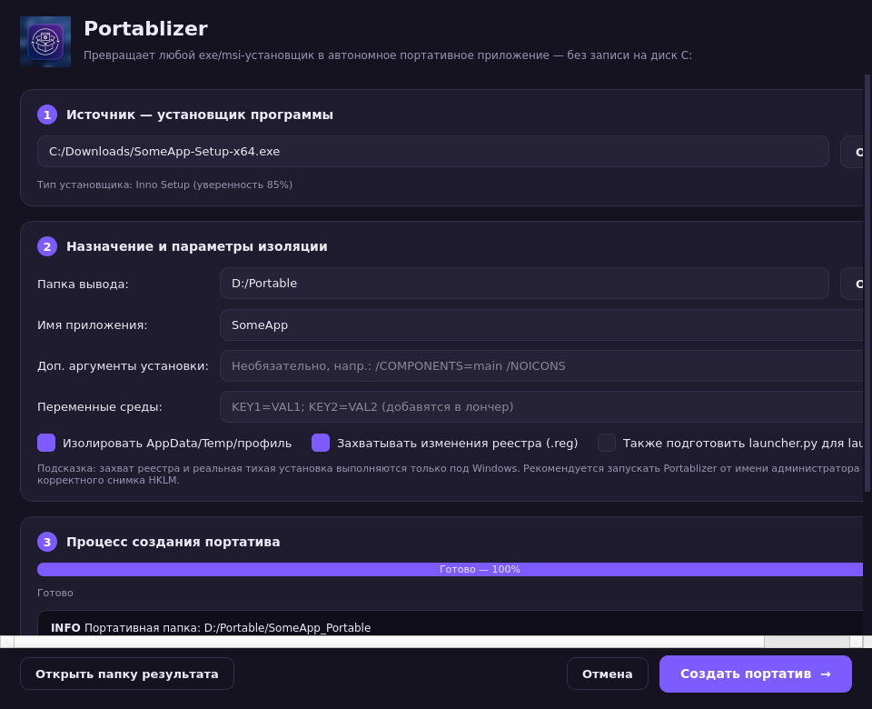

# Portablizer

**Portablizer** — приложение с современным графическим интерфейсом (PySide6/Qt),
которое помогает превратить распространённые **exe/msi-установщики** в
**портативные приложения**, работающие прямо из папки.

Portablizer запускает **тихую установку с перенаправленным пользовательским
окружением** в указанную папку, проверяет фактический результат и учитывает
локальные зависимости и переменные среды. Это не песочница: установщик всё
ещё может менять системный реестр, службы, драйверы и файлы Windows. Поэтому
Portablizer работает без повышения прав по умолчанию, не откатывает общий
снимок системы и не удаляет ярлыки/службы автоматически. Для неизвестных
установщиков используйте Windows Sandbox или виртуальную машину.



## Что делает

1. **Определяет тип установщика** по трём независимым признакам:
   * **структура PE** — настоящий WiX Burn-бандл опознаётся по секции
     `.wixburn`, а не по строке внутри файла (см. «Почему установщик
     определялся неверно» ниже);
   * **байтовые сигнатуры** движков (Inno Setup, NSIS, InstallShield,
     MSI/msiexec, WiX Burn, InstallAware, Wise, install4j, BitRock,
     Advanced Installer, self-extract). Короткие подстроки вроде `nsis`
     считаются **слабыми**: одно такое совпадение понижает уверенность, а
     не решает исход определения;
   * **раскладка диска рядом с установщиком** — `data1.hdr`, `setup.ins`,
     `ISSetup.dll`, соседний `.msi`, готовый `setup.iss`. По ней
     определяется **поколение InstallShield**: у классического
     InstallScript 5/6 и у современной обёртки над MSI командные строки
     несовместимы (см. «Старый InstallShield» ниже);
   * **ключи командной строки, которые установщик содержит внутри себя** —
     так распознаются современные bootstrapper'ы (`--silent`,
     `--installPath`, `--accept-license-agreement`), не относящиеся ни к
     одному классическому движку;
   * **профиль производителя** — у части вендоров (ZennoLab) строки внутри
     сборки упакованы, но имя файла стандартизовано
     (`ZennoPosterLite-RU-v7.9.2.0.exe`), а точный синтаксис тихой
     установки опубликован в официальной документации. Если движок не
     опознан уверенно, ключи берутся из документации производителя;
   * **движок Adobe HyperDrive** — `HDSetup`/`HDPIM`, стандартизованное имя
     (`Adobe.XD.v61.0.12.1.exe`) и раскладка `payloads` рядом с `setup.exe`.
     Установщики Adobe ставят программу двумя этапами — пакеты MSI и
     UWP-пакет, — и второй падает с «кодом ошибки 191». Он портативу не
     нужен, поэтому сборка вообще не запускает установщик, а раскладывает
     пакеты в `App` (см. «Adobe XD и Creative Cloud» ниже).
2. **Строит лестницу команд тихой установки** — не одну «правильную», а
   несколько вариантов от самого точного к самому общему. Portablizer
   выполняет их по очереди и останавливается на первом, который реально
   положил файлы в `App\`. Для **WiX Burn** в лестницу входят повтор без
   ключа `InstallFolder` (не все бандлы объявляют эту переменную, и тогда вся
   команда считается недопустимой) и распаковка бандла через `/layout` с
   последующей административной установкой (`msiexec /a`) извлечённых MSI
   прямо в `App\` — без установки в систему и без прав администратора. Если
   тип опознан ненадёжно, после команды предполагаемого движка автоматически
   идут универсальные наборы ключей (`/VERYSILENT`, `/quiet`, `--silent` …).
   Для **InstallShield** набор команд выбирается по поколению: обёртке над MSI
   уходит `/s /v"/qn INSTALLDIR=\"…\""`, классическому InstallScript —
   `/s /f1"setup.iss" /f2"setup.log" /SMS`.
   Для **Adobe HyperDrive** первым (и главным) сценарием идёт раскладка
   пакетов без запуска установщика: MSI ставятся административной
   установкой, ZIP распаковываются, UWP-пакет пропускается — шаг с кодом
   `191` не выполняется. Контейнер читается любым доступным архиватором
   (7-Zip, WinRAR или встроенным `tar.exe`), поэтому 7-Zip не обязателен.
   Запасные варианты — документированные ключи Adobe
   (`--silent --ADOBEINSTALLDIR=`, `/sAll /rs`, `/S`), а после них сборка
   забирает распакованные пакеты из `adobeTemp`.
   Если не сработала ни одна команда, а к exe приклеен ZIP, содержимое
   извлекается напрямую. Весь текстовый вывод установщика (stdout/stderr)
   сохраняется в `installer-output.log` — по нему видно точную причину
   отказа.
   **Падение установщика** (код `0xC000041D` и другие аварийные завершения) —
   отдельный случай со своими шагами: повтор той же команды, если сбой был
   разовым, запуск с окном прогресса (`/SILENT` вместо `/VERYSILENT`) и
   распаковка содержимого установщика **без его запуска** (см. «Установщик
   упал: `0xC000041D`…» ниже).
3. **Перенаправляет пользовательское окружение установщика**: каталоги
   (`APPDATA`, `LOCALAPPDATA`, `TEMP`, `USERPROFILE`, `PROGRAMDATA`) на время
   установки направляются внутрь портативной папки. Это не блокирует запись в
   HKLM, системные каталоги, регистрацию служб/драйверов и другие изменения
   Windows — для полной изоляции нужна отдельная виртуальная машина. Место под распаковку
   проверяется заранее: если на диске портатива его не хватает (большие игры
   распаковываются сначала в `TEMP`, и на диске должны уместиться и
   дистрибутив, и копия в `TEMP`, и результат), `TEMP` установщика
   переносится на другой диск и убирается сразу после сборки.
4. **Захватывает изменения реестра и сортирует их**: снимок HKCU/HKLM\Software
   до и после установки. Разница делится на три группы — настройки программы
   (едут в портатив), интеграция с оболочкой (по желанию), URL-протоколы
   (везде: браузерные глубокие ссылки) и следы установки
   (в портатив не попадают никогда, см. «Автономность» ниже).
   папку, ищет созданную программу в перенаправленном `LocalAppData`, новых
   каталогах `Program Files` и значениях `InstallLocation`, затем переносит её
   в `App/`. Если exe так и не найден, операция завершается ошибкой и сломанный
   `Launch.bat` не создаётся.
6. **Находит главный exe** установленной программы и **собирает зависимости**
   (папки с `.dll` добавляются в `PATH` лончера).
7. **Приносит в портатив распространяемые компоненты (Redistributables)** —
   Visual C++ 2005…2022, DirectX End-User Runtime (июнь 2010), UCRT, OpenAL и
   т. п. Список нужных библиотек читается из **таблиц импорта** самих exe/dll
   (включая отложенный импорт), а файлы берутся из комплекта установщика,
   системных папок этого ПК, WinSxS или официальных пакетов Microsoft.
   Поверх точного списка — по умолчанию — разворачивается **полный комплект
   «про запас»**: все известные версии всех библиотек рядом с каждым exe.
   Это закрывает целый класс ошибок вида «отсутствует `MSVCP110.dll`» и
   «отсутствует `XINPUT1_3.dll`» на чужом компьютере — в том числе для
   плагинов, модов и библиотек, которые программа грузит динамически по
   имени, собранному строкой (см. «Redistributables» ниже). Установка
   предусловий на компьютер-сборщик (`vcredist`, `DXSETUP`, OpenAL, PhysX)
   **выключена по умолчанию**, потому что это системное изменение; включить её
   можно явно. Пакеты и DLL по возможности копируются внутрь портатива.
8. **Генерирует портативные лончеры**: готовый самодостаточный
   `App\LaunchPortable.exe` (основной способ запуска двойным кликом), а также
   запасные `Launch.bat` и `LaunchHidden.vbs`. EXE не требует установленного
   Python: при каждом запуске он воссоздаёт окружение портатива, подставляет
   только отобранные настройки приложения, запускает программу и после её
   закрытия возвращает снимок этих ключей. Это не откат всей Windows и не
   песочница; системные ветки, активация, интеграция оболочки и WebView2
   автоматически не меняются.
9. **Делает сохранения сквозными**: один набор сейвов на все способы запуска.
   Прямой запуск `App\Game.exe`, `App\LaunchPortable.exe`, `Launch.bat` и
   комплектный `Launcher.exe` читают и пишут одни и те же файлы внутри
   портативной папки (см. «Сохранения» ниже).
10. **Сохраняет изменения компьютера-сборщика**: общего отката реестра,
    удаления ярлыков и остановки/снятия служб нет. Только по явной галочке
    можно удалить одну точно совпавшую новую запись приложения из списка
    «Установленные программы»; активация, ассоциации, taskbar pins, службы и
    Microsoft Edge WebView2 автоматически не трогаются.
11. **Переносит системные сетевые компоненты VPN-клиентов** (Planeta VPN и
    всё, что собрано вокруг OpenVPN): драйвер TAP-Windows («TAP-Windows
    Provider V9 network adapters»), пакеты wintun/ovpn-dco и конфигурацию
    служб-компаньонов — в папку `NetStack/`. Ядро Windows нельзя
    виртуализовать, поэтому портатив на каждом ПК проверяет драйвер и службы
    и досоздаёт недостающее из своих копий (один тихий UAC вместо зависшего
    окна «Безопасность Windows»). По умолчанию работает **изолированный
    режим**: всё, что портатив создал на хосте, снимается при выходе;
    чужие установки драйвера не трогаются (см. «VPN-клиенты и NetStack»).

Итоговая структура портатива:

```
MyApp_Portable/
├─ App/
│  ├─ LaunchPortable.exe ← основной запуск портатива двойным кликом
│  ├─ Saves/             ← сквозные сохранения: один набор на все запуски
│  └─ ...                ← файлы установленной программы
├─ PortableData/          ← все пользовательские данные (AppData, Temp, реестр)
├─ Launch.bat             ← запасной запуск (чистый ASCII)
├─ LaunchHidden.vbs       ← запасной запуск без окна консоли
├─ Launch_Launcher.exe    ← портативный официальный launcher (если найден)
├─ Launch_Configurator.exe← портативные настройки (если найдены)
├─ Launch_Launcher.bat    ← запасной запуск launcher через cmd
├─ Launch_Configurator.bat← запасной запуск настроек через cmd
├─ Launch_Menu.bat        ← единое меню всех найденных компонентов
├─ launcher_config.json   ← параметры лончера
├─ portable.reg          ← настройки программы (HKCU), путь — маркером
├─ portable_machine.reg  ← настройки HKLM (если были)
├─ cleanup_host.reg      ← (если подтверждено) удаление одной записи приложения
├─ cleanup_host.cmd      ← ручной UAC-хелпер только для этой записи
├─ redistributables.txt  ← какие системные библиотеки нужны и что уже внутри
├─ Redist/               ← установщики недостающих пакетов Microsoft
│  └─ Install-Redist.cmd ← ручная тихая установка (только по явному запуску)
├─ NetStack/             ← драйверы и службы VPN-клиентов (если найдены)
│  ├─ Setup.cmd          ← проверить/досоздать недостающее (один UAC)
│  ├─ Teardown.cmd       ← снять с хоста только созданное портативом
│  └─ netstack.json      ← манифест: пакеты, службы, режим изоляции
├─ install.log           ← журнал установщика (если поддерживается)
├─ installer-output.log  ← stdout/stderr установщика по каждой попытке
├─ installer-crash.log   ← где именно упал установщик (модуль, код исключения)
├─ unpacker-output.log   ← вывод распаковки без запуска (если применялась)
├─ portablizer.log       ← журнал создания и диагностики
├─ UpdatePortable.cmd    ← обновить программу ВНУТРИ портатива (см. «Обновление программы…»)
├─ Updates/              ← при обновлении: stage (временная установка), backup (прежняя версия)
└─ README_PORTABLE.txt
```

## Автономность и переносимость с флешки на флешку

Портатив рассчитан на сценарий «скопировал папку на флешку — работает на любом
ПК», без установки. Обычный запуск прав администратора не требует; UAC может
понадобиться только комплектному конфигуратору/лаунчеру старой программы,
который отказывается читать свои обязательные параметры вне HKLM.

**Программа не попадает в список «Установленные программы» чужого ПК.**
Записи ветки `Uninstall` (именно она формирует этот список), автозапуск `Run`,
данные Windows Installer и службы классифицируются как *следы установки* и в
портатив **не переносятся никогда** — переносятся только собственные настройки
программы. Если бы этого разделения не было, портатив при первом же запуске
«устанавливал» бы себя на каждый новый компьютер.

**Состояние компьютера-сборщика не откатывается вслепую.** Ранее общий
`cleanup_host.reg` мог удалять новые и восстанавливать изменённые ключи по
снимку до установки; такой способ не отличает изменения установщика от
активации, ассоциаций или настроек, которые Windows/другая программа записали
параллельно. Теперь общего отката нет. Portablizer:

* не восстанавливает и не удаляет произвольные ключи реестра;
* не удаляет ярлыки и не очищает закрепления панели задач;
* не останавливает и не удаляет системные службы;
* не откатывает и не изменяет ветки лицензирования Windows/Office, Microsoft
  Edge/WebView2 и других защищённых компонентов;
* не устанавливает runtime-пакеты на компьютер-сборщик по умолчанию.

По отдельной галочке можно удалить только новую запись приложения из списка
«Установленные программы», и только если DisplayName точно совпадает с именем
приложения, а путь указывает внутрь его портативной папки. Для этого рядом
сохраняются `cleanup_host.reg` и `cleanup_host.cmd`; скрипт сам запросит UAC,
но запускается только вручную. Все остальные записи остаются неизменными.

**Важно:** перенаправление `APPDATA`/`TEMP` — не полная виртуализация Windows.
Сам запущенный установщик всё ещё может записать данные в системные каталоги,
реестр, службы, драйверы и настройки оболочки. Portablizer не может безопасно
отменить неизвестные действия установщика; для сомнительных пакетов или
критичного ПК сначала используйте Windows Sandbox/виртуальную машину или
резервную копию.

**Запуск готового портатива на другом ПК** по умолчанию не импортирует
интеграцию с оболочкой (ассоциации файлов и COM). Если программе нужны свои
настройки реестра, лончер временно применяет только захваченные ключи
приложения и затем восстанавливает реестр. Лицензии, ассоциации, Taskbar и
регистрации WebView2 исключены из такого переноса.

### Почему установщик определялся неверно (код `-1` и пустая папка `App`)

Строка `WixBurn` внутри exe **не означает**, что перед нами WiX Burn-бандл:
она попадает в любой файл, который просто упоминает этот движок или несёт
Burn-пакет внутри себя. Прежняя версия верила строке, отправляла заведомо
чужому установщику ключи `/quiet /install InstallFolder=…`, тот не понимал
командную строку и завершался с кодом `4294967295` (`-1`, `0xFFFFFFFF`),
ничего не установив.

Теперь тип бандла подтверждается **секцией `.wixburn` в заголовке PE**, а для
установщиков с собственным интерфейсом командной строки ключи берутся из
самого бинарника. Например, установщики ZennoLab требуют

```bat
ZennoPosterLite-RU-v7.9.2.0.exe --silent --accept-license-agreement="https://zennolab.com/terms-of-service/"
```

— и Portablizer подставляет эти ключи (вместе с найденной ссылкой на
лицензию) автоматически, а не угадывает `/quiet`.

Была и вторая ошибка этого же рода. Свежая сборка `ZennoPosterLite` хранит
строки упакованными, поэтому `--silent` в бинарнике не находился, зато
находилась короткая подстрока `nsis` — и установщик получал тип «NSIS,
уверенность 70 %» с единственной командой `/S /D=…`, на которую отвечал
кодом `-1`. Теперь короткая подстрока — **слабая сигнатура**: без сильных
подтверждений («Nullsoft Install System») она лишь понижает уверенность, а
при узнаваемом имени файла продукта ZennoLab подключается **профиль
производителя** — точные ключи берутся из официальной документации
вендора, включая обязательное `--accept-license-agreement="…"` и
`--installType=StandAlone` (чистая установка в папку портатива, а не
обновление уже установленной на этом ПК копии). Если тип опознан ненадёжно,
после команды предполагаемого движка выполняется универсальная лестница
ключей, а вывод установщика (stdout/stderr) попадает в
`installer-output.log`.

Если установка всё же не удалась, вместо «смотрите журнал» выводится разбор
причины и план действий: нужны ли права администратора (проверяется
`requireAdministrator` в манифесте **до** запуска), какие ключи ожидает
установщик, сколько вариантов команды уже испробовано и **чем завершилась
каждая попытка** (код возврата или «код 0, но файлов в App не появилось»).
Тип, угаданный по профилю производителя, показывается честно —
`ZennoLab: Custom CLI bootstrapper`, а не абстрактное «bootstrapper».

### Старый InstallShield (InstallScript 5/6): почему «код 0, а папка пуста»

Диски и программы 1998–2002 годов (например, установщик
*American McGee's Alice*) собраны на **InstallShield InstallScript** —
это не та же программа, что современный `setup.exe` поверх MSI, хотя
сигнатуры внутри файла совпадают. Отличия принципиальны:

| | InstallScript 5/6 | Обёртка над MSI |
|---|---|---|
| тишина | `/s` **только** по файлу ответов | `/s /v"/qn"` |
| целевая папка | из файла ответов, не из командной строки | `INSTALLDIR=…` после `/v` |
| ключ `/v` | не существует | обязателен для параметров MSI |
| журнал | `setup.log` рядом с `setup.iss` (`/f2`) | лог msiexec |

Прежняя версия отправляла в такой установщик команду
`Setup.exe /s "/v/qn INSTALLDIR=… /norestart"`. Движок не понимал `/v`,
выходил через пару секунд **с кодом 0** и оставлял `App/` пустой, а причину
записывал в свой `setup.log`: `ResultCode=-3` — «в файле ответов нет нужных
данных». Portablizer этот журнал не читал и советовал пользователю проверить
лицензию, хотя дело было в командной строке.

Что делает Portablizer теперь:

* определяет **поколение** по раскладке диска и строкам внутри `setup.exe`;
* классическому InstallScript отправляет `/s /f1"…\setup.iss"
  /f2"…\setup.log" /SMS`, а файл ответов и журнал кладёт **в папку
  портатива** — установочный диск (`J:\`) обычно доступен только для чтения,
  и запись рядом с `setup.exe` завершилась бы ошибкой `-7`;
* найденный на диске `setup.iss` копируется в портатив, а путь установки в
  копии заменяется на папку `App` — так программа сразу попадает в портатив
  (оригинал на диске не изменяется);
* если папку задать нечем, программа ставится в каталог по умолчанию и
  **переносится** в `App` сразу же, не дожидаясь конца лестницы;
* `setup.log` читается, и `ResultCode` показывается расшифрованным —
  это точная причина отказа, а не догадка;
* если файла ответов нет, Portablizer прямо пишет, что тихий режим тут
  невозможен, и даёт готовую команду записи:

  ```bat
  "J:\Setup.exe" /r /f1"E:\Portable\Игра_Portable\setup.iss"
  ```

  Записанный `setup.iss` остаётся в папке портатива и подхватывается при
  следующей сборке автоматически — она пройдёт уже без единого окна;
* галочка **«Разрешить окно мастера установки»** делает то же самое без
  ручного запуска: Portablizer сам показывает мастер в режиме записи `/r`,
  сохраняет ответы и забирает установленную программу в портатив. По
  умолчанию она выключена — сборка остаётся полностью автоматической.

### Autodesk Fusion: `[WinError -2147024894]` и «Не удалось создать портатив»

`Fusion_360_Setup.exe` — это **сетевой загрузчик** Autodesk Application
Streaming, а не автономный дистрибутив: он весит несколько мегабайт и
скачивает клиент из сети в
`%LOCALAPPDATA%\Autodesk\webdeploy\production\<хеш сборки>`. Portablizer
перенаправляет `LOCALAPPDATA` внутрь портатива, поэтому скачанные гигабайты
остаются в `PortableData\AppData\Local\Autodesk\webdeploy`, а `App`
намеренно не заполняется копией клиента. Документированный ключ тишины —
`--quiet`; `--globalinstall` добавлять нельзя: он ставит клиент в `Program
Files` этого компьютера.

`[WinError -2147024894]` — это `0x80070002` (`ERROR_FILE_NOT_FOUND`).
Загрузчик Autodesk (как и многие .NET-бутстрапперы) спрашивает пути не
только через переменные `APPDATA`/`LOCALAPPDATA`, но и через Known Folder
API; Shell разрешает их как `%USERPROFILE%\AppData\...`. Если такого
каталога нет, `GetKnownFolderPath` возвращает «Не удается найти указанный
файл». Начиная с 1.14.18 Portablizer заранее создаёт **полное дерево**
перенаправленного профиля (`PortableData\User\AppData\{Roaming,Local,
LocalLow}`, `Documents`, `Saved Games`, ярлыки), каталог `User Pinned` в
обоих эквивалентных путях и вложенный `User Pinned\TaskBar`. Второй уровень
обязателен: Autodesk документирует, что Streamer закрепляет ярлык Fusion на
панели задач и без `TaskBar` завершается именно с
`[WinError -2147024894]`. Если окно всё равно появилось, проверьте: путь к
папке портатива без OneDrive и по возможности короткий ASCII-путь, на диске
есть место для распаковки, а сам загрузчик не запускается одновременно с
другой копией Autodesk.

Готовым результатом считается только настроенный `FusionLauncher.exe.ini`:
секция `[Launcher]`, `stream = production` и `cmd`, указывающий на
существующий `Fusion360.exe`. Placeholder-файл Streamer, `FusionDocTest.exe`
и пустой `App` ложным успехом не становятся. Клиент остаётся сетевым: для
запуска нужны интернет, вход в аккаунт Autodesk и действующая лицензия;
автономность на другом ПК не гарантируется.

### Adobe XD и Creative Cloud: «Код ошибки 191» при установке

```
Ошибка при установке
В настоящее время невозможно установить XD. (Код ошибки: 191)
```

`Adobe.XD.v61.0.12.1.exe` — это не один установщик, а связка: оболочка
(`Set-up.exe`), движок Adobe **HyperDrive** (`HDSetup`/`HDPIM`) и набор
пакетов в каталоге `payloads`. Движок ставит программу **двумя этапами**:

1. обычные пакеты (`*.msi`) — файлы самой программы;
2. UWP-пакет (Appx) шагом `AddUWPAppxCommand` — у XD это `SparklerApp.appx`
   (`Adobe.CC.XD`), который Windows регистрирует **сразу для всех
   пользователей** через DISM.

Код `191` — это отказ **второго** этапа, и он ничего не говорит о командной
строке: ошибку дают одни и те же причины, какие ключи тишины ни передавай.
Шагу нужны работающая служба `AppXSvc`, разрешение на установку
неопубликованных приложений (sideloading), системный том и повышение прав.
Отдельная беда в том, что этот шаг **не совместим с портативом в принципе**:
Windows регистрирует пакет на конкретном компьютере и для всех его
пользователей, а не «в папке». Официальные советы Adobe (переустановить
«App Installer», включить «Дополнительный вход в систему», поменять место
сохранения новых приложений) лечат именно UWP-часть Windows — и на многих
машинах не помогают вовсе.

Что делает Portablizer, начиная с версии 1.14.21:

* **распознаёт Adobe HyperDrive** — по строкам движка внутри файла
  (`HDPIM`, `AddUWPAppxCommand`, `adobeTemp`, `Adobe Desktop Common`,
  `UWPAssets`, `SparklerApp`), по стандартизованному имени
  (`Adobe.XD.v61.0.12.1.exe`) и по раскладке `payloads` +
  `Setup.xml`/`PackageInfo.txt` рядом с `setup.exe`. Настоящий движок внутри
  (Inno, NSIS, InstallShield) при этом не подменяется;
* **не запускает установщик вообще** — первым сценарием идёт раскладка
  пакетов: контейнер установщика читается архиватором (код установщика при
  этом не выполняется), а у пакета Adobe Admin Console пакеты берутся прямо из
  `Build\payloads`. **7-Zip не обязателен**: Portablizer пользуется тем, что
  уже есть на машине, — 7-Zip, WinRAR (`UnRAR.exe`/`Rar.exe`) или
  встроенным в Windows `tar.exe` (это bsdtar из libarchive, он читает ZIP, 7z
  и RAR/RAR5, а появился в Windows 10 ещё в 1803). Самораспаковывающийся EXE —
  это PE-загрузчик с дописанным архивом, поэтому для `tar.exe` и UnRAR архив
  сначала вырезается из обёртки. MSI ставятся административной установкой
  (`msiexec /a TARGETDIR=App`, как пакеты WiX Burn), ZIP распаковываются своей
  библиотекой (с защитой от `..` в архиве), а **Appx/MSIX пропускаются** — шаг
  с кодом 191 тогда просто не выполняется;
* **забирает пакеты из `adobeTemp`** — если контейнер не читается и
  установщик всё же запускался, он успевает разложить payload в
  `adobeTemp\ETRxxxx.tmp\N` **до** падения на UWP-шаге (и отката
  установки). Эти пакеты никуда не деваются: сборка находит их в TEMP
  установщика (он перенаправлен в `PortableData\Temp`) и в системном
  `adobeTemp`, и ставит в `App`;
* **объясняет отказ по существу**: журнал установщика разбирается на код,
  шаг (`AddUWPAppxCommand`), пакет и OS-код Windows (`0x80073CF3` — нет
  framework-зависимости, `0x80070422` — отключена служба AppX,
  `0x80073CFF` — запрещён sideloading, `0x80070490` — установка не на
  системный том…). Незнакомый OS-код не получает выдуманной расшифровки;
* **оставляет рядом `adobe-uwp.txt`** — что именно осталось за бортом
  (плитка в меню «Пуск», интеграция «Поделиться», UWP-ассоциации файлов) и
  почему это не мешает запуску программы.

Отдельно про **код 1000**: у Adobe это «установщик не смог начать работу» —
он сам или его носитель не на локальном диске, либо не хватает прав. В
сообществе Adobe это подтверждённый случай: с сетевого диска установщик
отвечает кодом 1000, стоит перенести файл на локальный — и он работает.
Поэтому Portablizer, увидев установщик на съёмном, сетевом или оптическом
диске, один раз копирует его на локальный и работает с копией (исходный файл
не меняется, копия удаляется после сборки). И главное: при рабочем
распаковщике установщик вообще не запускается, так что ни 191, ни 1000 не
возникают.

Что важно понимать: сама программа Adobe XD — обычное Win32-приложение, и без
UWP-пакета запускается. UWP-часть — это точки входа в оболочке Windows, а не
код программы. При этом вход в Creative Cloud и действующая подписка
по-прежнему требуются, и обновления Adobe проверяют лицензию через свои
службы: такой портатив — «программа в папке», а не автономная копия
лицензии. Если в сборке вообще нет MSI (только Appx), портатив собрать
нельзя: подсказка прямо скажет взять корпоративный пакет Adobe Admin Console
или offline-установщик с MSI.

Одно ограничение стоит назвать честно: общие компоненты Adobe
(`Program Files\Common Files\Adobe`) ставятся пакетами в `App` с сохранением
структуры и попадают в `PATH` лончера, но конкретная сборка может искать их
строго по абсолютному пути. Тогда программа запустится только там, где этот
путь существует; Portablizer не подменяет системные пути и не копирует файлы
в `Program Files` чужого компьютера — это уже не портативность, а изменение
системы.

### Inno Setup: код 7 или 8 — «подготовка установки не удалась»

У Inno Setup собственные коды возврата, и они не совпадают с Win32. Раньше
код `7` расшифровывался как «отказано в доступе», хотя на самом деле это
`PrepareToInstall`: установщик не смог подготовить следующий этап, а точная
причина лежит в `install.log`. Теперь Portablizer различает коды движка:
`1` — инициализация, `2` — отмена до начала, `3` — фатальная ошибка
подготовки, `4` — ошибка во время установки, `5`/`6` — отмена до/во время
копирования файлов, `7` — неудачная подготовка (смотрите `install.log`),
`8` — для продолжения нужна перезагрузка. Итоговая подсказка прямо называет
`PrepareToInstall` и `install.log`, а не «портативной сделать нельзя»: код
подготовки сам по себе не доказывает проблему с лицензией, `/DIR` или тихим
режимом.

### Установщик упал: `0xC000041D` и другие аварийные завершения (Hatred)

Портирование *Hatred* (офлайн-установщик GOG) заканчивалось предупреждением:

```
WARN Установщик вернул код 3221226525 (-1073740771, 0xC000041D).
Похоже, процесс установщика аварийно завершился: как правило, не хватило
прав администратора или тихий режим не поддерживается.
```

Диагноз был **неверным по существу**. `0xC000041D` — это
`STATUS_FATAL_USER_CALLBACK_EXCEPTION`: установщик уже стартовал, уже работал
и был оборван исключением внутри своего callback’а (обычно это оконная
процедура — отрисовка прогресса, таймер, перечисление файлов). Коды вида
`0xC0000…` — это NTSTATUS, а не «код ошибки движка»: к командной строке и к
правам администратора они отношения не имеют, и совет «повысьте права» уводил
от настоящих причин.

**Что теперь видно и что теперь делается.**

1. **Точная расшифровка.** У каждого кода аварийного завершения есть имя и
   смысл: `0xC000041D` — исключение в callback’е, `0xC0000005` — обращение к
   недоступной памяти, `0xC0000006` — ошибка чтения дистрибутива,
   `0xC0000135`/`0xC0000142` — не нашлась или не смогла загрузиться
   библиотека (часто недостающий .NET/VC++), `0xC0000017` — не хватило
   памяти, `0xC00000FD`/`0xC0000409` — переполнение стека и сторожевое
   срабатывание защиты компилятора. Отдельно опознаются `0xE0434352` (так
   завершаются бутстрапперы на .NET) и `STATUS_INVALID_HANDLE` /
   `STATUS_NO_SUCH_DEVICE` — последний означает, что во время установки пропал
   носитель: отключили флешку или внешний диск.
   **Правило шире таблицы**: аварийным завершением считается **любой** код из
   полосы фатальных NTSTATUS (`0xC0000000–0xC000FFFF`), даже если его в
   таблице нет. Иначе редкий код снова получил бы общий совет «не хватило прав
   администратора» — то есть ровно тот неверный диагноз, из-за которого всё
   это и делалось. Для неизвестного кода Portablizer честно говорит, что
   расшифровки нет, не повторяет запуск вслепую и отправляет к отчёту, где
   назван упавший модуль.
   Общая фраза про права администратора осталась только там, где она уместна:
   для `exit(-1)` (`0xFFFFFFFF`) — «не понял командную строку» — и кодов вне
   полосы фатальных NTSTATUS.

2. **Факты вместо догадок.** После падения читается журнал событий Windows
   (Application, Event ID 1000): там записан **модуль, в котором упал
   процесс**, и код исключения. По модулю видно принципиальную разницу —
   упал сам установщик (значит дело в дистрибутиве, команде или условиях)
   или упала сторонняя библиотека (антивирус, оверлей, инжектор, влезшие в
   чужой процесс). Всё это сохраняется в `installer-crash.log` рядом с
   `portablizer.log`, а не растворяется в одной строке предупреждения.
   В отчёт (и в строку диагностики в окне) попадает **версия Portablizer**:
   одна и та же жалоба «упал с кодом `0xC000041D`» у разных версий означает
   разное, и по отчёту сразу видно, какая сборка его написала.

3. **Шаги, применимые именно к падению** (лестница ключей тут не помощник —
   установщик не «не понял» команду, он упал):
   * **повтор той же команды** — ровно один раз и только если процесс упал
     через считанные секунды после старта, ничего не записав: такие сбои
     часто разовые (антивирус проверял файл, не хватило памяти в момент
     распаковки). Падение после часа работы повторять бессмысленно;
   * **окно прогресса вместо полной тишины** — в `/VERYSILENT` установщик
     Inno Setup вообще не создаёт окно, а в `/SILENT` создаёт: это другой
     путь в его коде, и падение в отрисовке прогресса на нём не повторяется.
     Такой сценарий добавляется в лестницу автоматически (и не дублируется,
     если подходящий запуск там уже есть);
   * **распаковка без запуска** — Inno Setup и NSIS это обычные упакованные
     контейнеры: установленный на компьютере 7-Zip читает их напрямую, не
     выполняя код установщика, — система при этом не меняется и права
     администратора не нужны. Файлы из `{app}` раскладываются в `App`,
     а служебные «корни» (`{tmp}`, `{sys}`, `{userappdata}`) не переносятся:
     подмена системных файлов чужого ПК — это не портативность. Свой
     распаковщик Portablizer с собой не носит и из сети не скачивает: сборка
     не должна молча тянуть исполняемые файлы. Если 7-Zip не установлен, об
     этом честно сказано в подсказках; если содержимое достали — это видно
     и в итоговом окне (настроек в реестре после такой сборки нет, их задаст
     сама программа при первом запуске).

4. **Место на диске — причина падений номер один, и её больше не пропускают.**
   Офлайн-установщики GOG распаковывают данные **сначала в `TEMP`** и только
   потом переносят их в целевую папку: на диске в момент установки должны
   уместиться дистрибутив, распакованная копия и результат — примерно
   **два веса дистрибутива**. Portablizer перенаправляет `TEMP` внутрь
   портативной папки (правильно: после сборки компьютер остаётся чистым), но
   у диска портатива появляется второй потребитель места. Поэтому вес
   дистрибутива (вместе с частями `setup_*.bin`) и свободное место
   сравниваются **до** запуска установщика: если места не хватает, `TEMP`
   установщика переносится на самый свободный диск (это видно в журнале — с
   числами), а временная папка удаляется сразу после сборки. Если свободного
   диска нет вовсе, сборка честно говорит об этом заранее, а не падает
   загадочным кодом через полчаса.

5. **Что советуют подсказки после падения** (в порядке вероятности):
   проверьте свободное место на диске портатива (числами), целостность
   дистрибутива — у GOG все части `.bin` должны лежать рядом и называться так
   же, как `setup_*.exe`, а недокачанная часть ломает установщик; добавьте
   установщик в исключения антивируса; посмотрите `installer-crash.log`, где
   назван упавший модуль; и только потом — «поставьте 7-Zip, сборка распакует
   установщик без запуска».

### VPN-клиенты и NetStack: драйвер TAP-Windows, службы и окно «Безопасность Windows»

VPN-клиенты на OpenVPN (Planeta VPN и подобные) не работают без системного
драйвера сетевого адаптера TAP-Windows (`tap0901`, «TAP-Windows Provider V9
network adapters») и, у части вендоров, службы. Ядро Windows нельзя
виртуализовать, поэтому Portablizer делает следующее:

1. **Находит пакет драйвера внутри `App`**: `.inf` с `Class=Net` и
   опознаваемым издателем/hwid (TAP-Windows, wintun, ovpn-dco), рядом —
   `.sys`/`.cat`/`.dll`, утилиты `tapinstall.exe`/`devcon.exe` и запасные
   установщики пакетов. Чужие сетевые адаптеры (Intel и т. п.) и файлы
   другого класса не переносятся.
2. **Переносит службы-компаньоны**: берёт службы, зарегистрированные на этом
   ПК, чей бинарник лежит в папке портатива, и переписывает `ImagePath` на
   маркер `@@PORTABLE_ROOT@@`. Службы ядра (драйверы) в манифест не входят.
3. **Собирает `NetStack/`**: копии пакетов, `netstack.json`, `Setup.cmd`,
   `Teardown.cmd` и `NetStackServices.ps1`. `Setup.cmd` сначала проверяет,
   что уже есть (реестр/`sc query`), и только затем публикует недостающее
   через `pnputil /add-driver` (запас — `tapinstall`); службы регистрирует
   PowerShell по манифесту, пути с кириллицей остаются в JSON.
4. **Изолированный режим — по умолчанию.** `Setup.cmd` снимает список
   `%SystemRoot%\INF\oem*.inf` до и после публикации; разница — пакеты,
   которые создал именно портатив (`driver-packages.txt`). `Teardown.cmd`
   снимает созданные службы, устройства адаптера и только эти пакеты
   (`pnputil /delete-driver oemNN.inf /uninstall /force`); занятое ядром
   удаление откладывается в `pending-driver.txt`. Драйвер, который уже стоял
   на машине (например, от отдельно установленного OpenVPN), используется,
   но никогда не объявляется своим и не удаляется.
5. **Режим общего компонента** — снятая галочка изоляции или
   `--shared-netstack`: драйвер остаётся в системе, как Visual C++ из
   `Redist`; службы всё равно снимаются по маркеру. Вручную:
   `NetStack\Setup.cmd`, `NetStack\Teardown.cmd`, `--keep-driver` или
   `--remove-device`.
6. **Окно «Безопасность Windows — Установить программное обеспечение для
   данного устройства?»** распознаётся отдельно от прочих диалогов. Тихая
   установка на нём просто висит. Portablizer ставит галочку «Всегда
   доверять программному обеспечению <издателя>» и нажимает именно
   «Установить» (никогда «Не устанавливать»); число таких окон попадает в
   журнал и в подсказки, если установка всё же не удалась.

### Redistributables: «отсутствует MSVCP110.dll», «XINPUT1_3.dll не найден»

Самая частая причина, по которой правильно собранный портатив не стартует на
чужом ПК, — не программа, а **распространяемые компоненты Microsoft**:

```
Запуск программы невозможен, так как на компьютере отсутствует XINPUT1_3.dll.
Не удалось запустить приложение: отсутствует MSVCP110.dll.
```

Так выглядят `XINPUT1_3.dll`, `d3dx9_38.dll`, `d3dx9_39.dll`, `MSVCP110.dll`,
`MSVCR110.dll`, `MSVCP100.dll`, `MSVCR100.dll` и ещё пара сотен подобных
файлов. Это **не файлы программы**: их ставит в систему `vcredist_x86.exe`
или `DXSETUP.exe`, которые обычный установщик запускает как предусловие. На
компьютере-сборщике они уже есть — и всё работает; на чужом их может не быть.

Portablizer закрывает это **заранее**, на шести уровнях.

**1. Точный список, а не догадки.** У каждого `.exe`/`.dll` в `App`
читается **таблица импорта PE** — обычная и отложенная (delay-load). Именно
по ней загрузчик Windows будет искать файлы, поэтому список получается ровно
тот, который нужен. Отложенный импорт учитывается специально: `XINPUT1_3.dll`
и `xaudio2_7.dll` игры грузят именно так, и ошибка всплывает не при старте, а
в середине игры.

**2. Классификация каждой библиотеки.** Три исхода:

| | что это | что делает Portablizer |
|---|---|---|
| `engine.dll`, `bink2w64.dll` | файлы самой программы | ничего, они уже в папке |
| `kernel32.dll`, `d3d9.dll`, `xinput1_4.dll` | часть Windows | ничего, есть везде |
| `msvcp110.dll`, `d3dx9_39.dll`, `ucrtbase.dll` | распространяемый пакет | приносит в портатив |

Каталог пакетов покрывает Visual C++ 6.0/2002/2003/2005/2008/2010/2012/2013 и
2015–2022 (включая UCRT и заглушки `api-ms-win-crt-*`), DirectX End-User
Runtime июня 2010 (`d3dx9_24…43`, `d3dx10_*`, `d3dx11_*`, `d3dcompiler_33…43`,
`xinput1_1…1_3`, `xaudio2_0…2_7`, `x3daudio1_*`, `xapofx1_*`, XACT), MFC/ATL,
OpenMP, OpenAL, PhysX, VB6-runtime и Games for Windows – LIVE.

**3. Лестница источников** — от самого точного к самому общему:

1. **комплект установщика** — `_CommonRedist`, `redist`, `DirectX`,
   `Prerequisites` рядом с exe установщика (repack-сборки и диски игр почти
   всегда несут нужные версии с собой; при необходимости `.cab` и `.msi`
   распаковываются через `expand`/`msiexec /a` без установки в систему);
2. **системные папки этого ПК** — `System32`/`SysWOW64` с **обязательной
   проверкой разрядности**: 64-битный `msvcp100.dll` 32-битной игре не просто
   бесполезен, а вреден;
3. **WinSxS** — для VC++ 2005/2008, которые живут только там. Рядом с
   программой создаётся **private-манифест сборки** (`Microsoft.VC90.CRT.manifest`)
   с той версией, которую запрашивает манифест самой программы, иначе Windows
   проигнорирует копию рядом с exe и скажет «параллельная конфигурация
   неправильна»;
4. **официальные пакеты Microsoft** — только если включена галочка
   «Скачивать недостающие пакеты»: сборка не ходит в сеть без спроса.

Найденные файлы кладутся **рядом с каждым исполняемым файлом, который их
запрашивает**, — это единственное место, которое загрузчик Windows проверяет
всегда. Библиотеки, спрятанные установщиком в служебную подпапку
(`App\redist\msvcr110.dll`), тоже дублируются к exe. К заглушкам
`api-ms-win-crt-*` автоматически докладывается `ucrtbase.dll`: без него они
бесполезны на Windows 7/8.1. Из одного пакета достаются **все** заказанные
библиотеки: если программе нужны и `d3dx9_38.dll`, и `d3dx9_39.dll`, оба
кабинета из `directx_Jun2010_redist.exe` будут развёрнуты.

**3a. Собственный распаковщик кабинетов — распаковка больше ни от кого не
зависит.** Раньше пакет вскрывался чужими руками: Portablizer запускал сам
`vcredist_x86.exe` с ключом распаковки (`/T:`, `/x:`, `/layout`) или звал
`expand`. Это срывалось по причинам, которые от Portablizer не зависят:
пакет разбирает путь **сам, внутри одного аргумента** (пробел обрывает
путь, кириллица в профиле пользователя разбирается как мусор, длинный путь
упирается в MAX_PATH), запуск чужого exe может быть запрещён политикой или
антивирусом, а `expand` может отсутствовать в PATH. Отсюда и брались
сообщения «пакет скачан, но распаковать его автоматически не удалось».

Теперь в `portablizer/core/cabinet.py` живёт **свой читатель CAB**: все эти
пакеты — это PE с приклеенными кабинетами (`MSCF`), и они читаются
напрямую, штатным `zlib` (MSZIP — это deflate с историей между блоками).
Ничего не запускается, никаких путей в командной строке:

* `vcredist_x86.exe` VC++ 2005/2008/2010 — обёртка IExpress: внутри
  `vc_red.msi` и `vc_red.cab`, вложенный кабинет раскрывается рекурсивно;
* `vcredist_x86.exe` VC++ 2012/2013 и `vc_redist.x64.exe` 2015–2022 —
  бандлы WiX Burn: к PE приклеено несколько контейнеров, и это тоже
  кабинеты;
* `directx_Jun2010_redist.exe` — снова IExpress: оттуда достаётся
  `DXSETUP.exe` и нужные кабинеты;
* `.cab` и `.msi` рядом с установщиком игры — так же, без `expand` и без
  `msiexec /a` (и, значит, без прав администратора).

Внешние инструменты остались **запасными** ступенями: запуск пакета с
ключом по его движку (`/Q /C /T:` для wextract, `/layout` для Burn,
`msiexec /a` для MSI) в путь без пробелов и не-ASCII (короткое имя 8.3,
иначе временная папка, иначе `%PUBLIC%`), затем `expand`/`extrac32`
(по абсолютному пути в `System32`, а не по PATH) и 7-Zip, если он есть.
Они нужны только для редких кабинетов LZX/Quantum.

Дополнительно к этому:

* **скачанное проверяется**: если по ссылке пришла HTML-страница, редирект
  или обрывок, это видно сразу (сигнатура `MZ`/`MSCF`/MSI и разумный
  размер), и Portablizer берёт **запасную ссылку** — у каждого пакета
  VC++ 2005–2013 их теперь минимум две. Сообщение тоже честное: «сервер
  вернул веб-страницу вместо файла», а не «распаковать не удалось»;
* библиотеки внутри `vc_red.cab` лежат под «складскими» именами таблицы
  File установщика (`FL_mfc80_dll_01_8.0.50727.762_x-ww_…`), и поиск
  распакованного это учитывает — иначе `mfc80.dll` «не находился» в
  полностью распакованном пакете;
* у VC++ 2005 SP1 прописаны прямые ссылки на официальные пакеты
  (MFC Security Update, 8.0.50727.6195) — именно в них лежат `mfc80.dll`,
  `mfc80u.dll` и `atl80.dll`;
* private-манифест сборки для VC++ 2005/2008 создаётся **независимо от
  источника файла** (WinSxS, System32 или распакованный `vcredist`): без
  него Windows игнорирует копию рядом с exe.

**3b. DirectX ставится в два шага.** `directx_Jun2010_redist.exe` — не
установщик, а архив: любой ключ тихого режима он передаёт вложенному
`DXSETUP.exe`, а тот знает ровно один (`/silent`) и на всё остальное
отвечает модальным окном «Установка DirectX — Неверная операция командной
строки». Поэтому бандл сначала **распаковывается** (своим читателем
кабинетов — сам бандл при этом даже не запускается), и только потом
запускается `DXSETUP.exe /silent` — и при сборке, и в
`Redist\Install-Redist.cmd`, и в `LaunchPortable.exe` на целевом ПК.

**3в. Пакет опознаётся по имени, а не по упаковщику — и молчит.** Два
модальных окна, которые раньше останавливали сборку посреди процесса,
имели общую причину: тип пакета определялся по сигнатуре **упаковщика**
внутри exe, а она говорит не о том. `vcredist_x86.exe` VC++ 2005 и
`directx_Jun2010_redist.exe` собраны одним и тем же wextract, и оба
опознавались как «IExpress» — с общей лестницей ключей `/Q`, `/q`,
`/quiet`:

* VC++ 2005 понимает ровно `/q`, а на `/quiet` показывает
  **«Command line option syntax error. Type Command /? for Help»**;
* бандл DirectX вообще не установщик: любой ключ он передаёт вложенному
  DXSETUP, и тот отвечает **«Установка DirectX. Неверная операция
  командной строки»**.

Теперь правило белого списка (что это за пакет) сильнее сигнатуры (чем он
упакован). Исключение одно — секция `.wixburn`: она бывает только у WiX
Burn и важнее имени файла, потому что VC++ 2012/2013 зовутся
`vcredist_x86.exe`, как и старые пакеты. Сверх того, VC++ 2005–2010
**вообще не запускается**: его обёртка вскрывается своим читателем
кабинетов, а лежащий внутри `vc_red.msi` ставится штатным
`msiexec /qn /norestart` — у обёртки не остаётся ни единого шанса
показать окно. То же исправление уходит и в `Redist\Install-Redist.cmd`
портатива.

И на случай, если **сам установщик игры** запускает вложенный `DXSETUP.exe`
со своими ключами (`/quiet`, `/q`, `/S`…) — DXSETUP понимает только
`/silent` и на всё остальное отвечает «Установка DirectX — Неверная
операция командной строки»:

* на время сборки Portablizer ставит Image File Execution Options на
  `DXSETUP.exe`: Windows перехватывает *любой* запуск (и наш, и вложенный
  из `directx_*_redist.exe`) и стартует его уже с `/silent`. Неверные
  аргументы до процесса не доходят, поэтому окна с ошибкой **нет**;
* любой собственный запуск (`_run_quiet`, тихая установка пакета) тоже
  принудительно сводится к `DXSETUP.exe /silent`;
* если перехват недоступен (нет прав администратора), остаётся запасной
  путь: Portablizer сам нажимает OK (и Yes To All на запросах IExpress
  «перезаписать файл»);
* если окно всё же не закрылось, зависший установщик снимается **вместе со
  всем деревом процессов** (`taskkill /T /F`, иначе окно показывает уже его
  ребёнок и переживает сборку), предел ожидания для обычных пакетов снижен
  с 15 до 5 минут (DirectX, .NET и обновления Windows по-прежнему получают
  15), а перебор ключей после таймаута **прекращается**: раз пакет не
  ответил, следующие попытки только покажут то же окно ещё раз.

**3г. Распаковка идёт целевая — минуты превратились в секунды.** В
`directx_Jun2010_redist.exe` около сотни кабинетов, и раньше распаковщик
разворачивал их все, даже когда нужна была одна `d3dx9_43.dll`: каждый
кабинет — LZX, а декодер LZX написан на Python. Теперь имя нужной
библиотеки передаётся вглубь: кабинеты, чьё имя её содержит
(`Jun2010_d3dx9_43_x86.cab`), берутся первыми, и как только файл найден,
перебор останавливается. Полный перебор остался запасным путём — он
просто почти никогда не нужен. Перед запуском `DXSETUP.exe` бандл
распаковывается в режиме «не разворачивать вложенное»: DXSETUP ставит
DirectX сам, и кабинеты нужны ему кабинетами. А на Windows обычный `.cab`
сначала отдаётся нативному `expand` — на LZX он в десятки раз быстрее
собственного декодера, который остаётся надёжным запасным вариантом.

**3д. Payload'ы WiX Burn больше не теряются.** VC++ 2012–2022 хранят
вложенные `.msi` и `.cab` под служебными именами **без расширения**
(`a0`, `u1`). Вложенное искали по расширению — и не находили: отсюда
предупреждение «Microsoft Visual C++ 2013 Redistributable: пакет скачан,
но распаковать его автоматически не удалось». Теперь вложенные
контейнеры определяются по сигнатуре (`MSCF`, `MZ`, составной документ
OLE), а не по имени. Если распаковать пакет всё-таки не удалось,
предупреждения с советом «включите галочку» больше нет там, где включать
нечего. По умолчанию Portablizer не запускает недостающий системный пакет:
он сообщает о нём и, если пакет удалось сохранить, кладёт его в `Redist` для
ручного запуска. Это может потребовать UAC и изменить Windows; скачивание и
тихая установка на компьютер-сборщик доступны только как отдельные явные
параметры.

**4. Полный комплект «про запас» — по умолчанию.** Таблица импорта отвечает
на вопрос «что программа требует точно», но не видит библиотек, которые
грузятся динамически по имени, собранному строкой (игры делают так с
`d3dx9_%d.dll`), подключаются плагинами и модами или оказываются нужны после
того, как установщик докачал компонент. Поэтому Portablizer заранее
раскладывает рядом с каждым exe **весь каталог известных библиотек**: все
версии Visual C++ 2005–2022 (`MSVCP100.dll`, `MSVCR100.dll`,
`MSVCP110.dll`, `MSVCR110.dll`, `msvcp140.dll`, MFC/ATL/OpenMP…), весь
DirectX End-User Runtime (`XINPUT1_3.dll`, `d3dx9_24…43.dll`,
`d3dx10/11_*`, `d3dcompiler_*`, `xaudio2_*`, XACT, `x3daudio1_*`,
`xapofx1_*`), старые runtime'ы VC6/2002/2003, OpenAL, PhysX, VB6-runtime и
даже `xlive.dll` — всего около 180 файлов на разрядность. Файлы берутся из
тех же источников, что и обязательные; то, чего на компьютере сборки нет,
просто пропускается. Такой портатив больше на десятки мегабайт, зато окно
«отсутствует dll» не возникает **в принципе**. Ненайденное «про запас»
ошибкой не считается: оно попадает в отдельный раздел отчёта
`redistributables.txt` и не попадает в предстартовую проверку лончера —
пользователь не получит предупреждение о файле, который программа,
скорее всего, вовсе не просит.

**5. Честный остаток.** Если файл не нашёлся нигде, Portablizer не делает
вид, что всё хорошо:

* в корне портатива появляется `redistributables.txt` — что нужно, что уже
  внутри, что придётся поставить, с прямыми ссылками на пакеты Microsoft;
* список попадает в `launcher_config.json`, и **лончер проверяет его перед
  запуском**: если на этом ПК библиотеки действительно нет, пользователь
  увидит название пакета и ссылку, а не системное окно «отсутствует
  MSVCR110.dll». Проверка не отменяет запуск — часть компонентов нужна не
  всегда;
* переменные окружения читаются **в любом регистре** (`SystemRoot` и
  `SYSTEMROOT` — одна переменная): копия окружения в лончере хранит ключи
  в верхнем регистре, и регистрозависимый поиск молча терял `SystemRoot`,
  проваливаясь на `WINDIR` — из-за этого зонд WinSxS для VC++ 2005/2008
  мог проверить не тот каталог и «не заметить», что сборки нет;
* в GUI по окончании сборки выводится и список принесённого, и список
  недостающего.

**6. Системные runtime-пакеты — только по явному действию.** По умолчанию
Portablizer не устанавливает VC++, DirectX, OpenAL, PhysX и другие runtime-пакеты
ни на компьютер-сборщик, ни при запуске портатива на целевом ПК. Он старается
перенести необходимые файлы в `App`; если это не удалось, сохраняет доступный
установщик в `Redist`, показывает недостающие компоненты и ссылки, но не
запускает пакет автоматически. `Redist\Install-Redist.cmd` можно запустить
вручную после проверки источников; тихий режим не означает изоляцию и скрипт
может запросить UAC и изменить Windows.

Опция **«Ставить redistributables молча (без окон с “OK”)»** включает тихую
установку опознанных пакетов на компьютер-сборщик; это отдельное согласие на
системное изменение и может требовать прав администратора. Скачивание
отсутствующих пакетов с сайта Microsoft также выключено по умолчанию.

Установщик самого приложения — сторонний код. Он всё ещё может запускать
собственные предусловия или менять реестр, службы, ассоциации, системные
каталоги и пользовательский профиль: перенаправление `APPDATA`/`TEMP` и другие
механизмы Portablizer не являются полной виртуализацией Windows. Поэтому для
незнакомых установщиков используйте Windows Sandbox или виртуальную машину;
не считайте успешную тихую установку гарантией чистоты хоста.

Проверка и перенос отключаются галочкой «Встраивать Visual C++ / DirectX в
портатив» (по умолчанию включена). Полный комплект «про запас» отключается
галочкой «Полный комплект библиотек (все версии VC++ и DirectX)» (по
умолчанию включена) — тогда рядом с exe ложится только то, что требует
таблица импорта. Файлы VC++ Runtime разрешено распространять вместе с
программой — см. условия лицензии Visual Studio.

### Почему сборка «зависала на 82%» и что теперь видно

Этап «Распространяемые компоненты (VC++, DirectX)» — самый долгий: пакет
`directx_Jun2010_redist.exe` весит около 98 МБ, а внутри него почти сотня
кабинетов. Раньше на время загрузки и распаковки интерфейс замирал: общая
полоса стояла на 82%, в журнале висела одна строка «Скачиваю DirectX
End-User Runtime…», и сборка выглядела мёртвой.

Теперь ход работ виден постоянно:

* **вторая полоса прогресса** под общей показывает текущую операцию —
  `Скачиваю DirectX End-User Runtime (июнь 2010): 41.3 МБ из 98.2 МБ,
  3.1 МБ/с, осталось ~0:18 — 42%`;
* если сервер не сообщил размер файла, полоса становится «бегущей», а не
  замирает на нуле;
* **общая полоса** внутри этапа 82 → 87% движется по мере разбора
  библиотек (`Компоненты: d3dx9_43.dll (14 из 62)`);
* **распаковка** кабинетов тоже считается: `Распаковываю
  Jun2010_d3dx9_43_x86.cab (14 из 97)`;
* в журнал каждые 5% пишется строка о ходе загрузки — её видно и в
  `portablizer.log`;
* тихая установка показывает прошедшее время, объём уже распакованного и
  время тишины, чтобы отличить долгую работу от настоящего зависания
  (см. «BioShock Infinite и другие большие игры» ниже).

Заодно загрузка стала честнее: обрыв соединения (получено меньше, чем
обещал `Content-Length`) считается ошибкой, файл-огрызок удаляется, и
Portablizer переходит к запасной ссылке, а не пытается распаковать
половину пакета. Кнопка «Отмена» прерывает и загрузку тоже.

### Почему сборка «висла на 85%» уже ПОСЛЕ того, как DirectX докачался

Загрузка показывала честные проценты до 100%, а вот сразу за ней шли два
шага, у которых точки прогресса не было вовсе — и оба ровно по адресу
`directx_Jun2010_redist.exe` (почти 100 МБ, около сотни кабинетов внутри):

1. **свой распаковщик кабинетов** (`cabinet.py`) читает LZX/MSZIP побитно
   на чистом Python — без сторонних библиотек, зато на таком большом пакете
   заметно медленнее штатного `expand`/wextract;
2. **тихая установка `DXSETUP.exe /silent`** — это один блокирующий вызов
   `Popen.wait(timeout=300)`: пока DXSETUP работает, наружу не долетало ни
   одной строчки вплоть до самого конца (или до истечения всех 5 минут).

Из интерфейса это выглядело абсолютно одинаково что при «ещё работает
неспешно», что при «зависло навсегда» — отличить одно от другого можно было
только по секундомеру и терпению. Теперь оба шага:

* **ограничены по времени.** Свой декодер кабинетов запускается в отдельном
  потоке с потолком (`CABINET_DECODE_TIMEOUT`, по умолчанию 60 с): не
  уложился — сборка не ждёт дальше, а сразу переходит к штатному
  `expand`/wextract (ступень 2-3 лестницы распаковки), который для такого
  большого пакета почти всегда и так быстрее;
* **докладывают о себе, пока работают.** В журнал (и в `portablizer.log`)
  каждые несколько секунд уходит строка вида «Распаковываю
  directx_Jun2010_redist.exe… (12 с — большой пакет, это не зависание)» или
  «DirectX End-User Runtime: установка идёт уже 40 с из 300 — это нормально
  для крупных пакетов (DirectX, .NET, обновления Windows), ждём.» — секунды
  идут, значит сборка жива;
* **действительно останавливаются по тайм-ауту.** Декодер проверяет сигнал
  отмены между блоками MSZIP/LZX и внутри длинных LZX-кадров. Раньше внешний
  код через 60 секунд лишь переставал ждать daemon-поток, но сам поток
  продолжал грузить CPU и писать в ту же папку одновременно со штатным
  `expand`; несколько таких «брошенных» потоков снова замораживали сборку.
  Теперь тайм-аут кооперативно завершает декодер и только после этого включает
  следующую ступень, без фоновых гонок и незавершённых файлов.

Кроме двух конкретных шагов, у доставки **каждой отдельной библиотеки**
теперь есть и общий потолок (`REQUIREMENT_TIMEOUT`, 15 минут) — последний
рубеж обороны. Он оборачивает всю лестницу источников (комплект
установщика → системные папки → WinSxS → распакованный пакет → загрузка с
сайта Microsoft → тихая установка в систему) целиком: даже если зависнет
шаг, для которого ещё не написан отдельный таймаут, сборка не останется на
одном месте дольше 15 минут — библиотека будет честно названа недостающей,
и доставка продолжится со следующей.

### Почему «висло» повторялось СНОВА, хотя каждый шаг уже был ограничен по времени

После двух предыдущих исправлений оставалась незаметная, но самая тяжёлая по
последствиям дыра — не в отдельном шаге, а в том, как «Полный комплект
библиотек» (галочка включена по умолчанию) обращается с одним и тем же
пакетом. DirectX End-User Runtime (июнь 2010) в полном комплекте отвечает не
за одну библиотеку, а почти за **сотню** (`d3dx9_24`…`d3dx9_43`, `d3dx10_*`,
`d3dx11_*`, `xinput1_1/2/3`, `xaudio2_0`…`_7`, `xactengine2/3_*`,
`x3daudio1_*`, `xapofx1_*` — и так далее): все они числятся отдельными
требованиями, но их всех обязан принести один и тот же файл
`directx_Jun2010_redist.exe`, поэтому распаковка/закачка этого файла
кэшируется — чтобы не разворачивать сотню кабинетов сто раз подряд.

Кэш, однако, записывался только **после того, как** попытка успешно
завершалась. Если распаковка или закачка этого единственного файла
оказывалась медленнее, чем `REQUIREMENT_TIMEOUT`, и сборка её бросала
(«не дождалась — библиотека недоступна, идём дальше»), запись в кэш так и не
происходила: фоновый поток продолжал где-то доделывать своё дело, но следующая
DLL из того же комплекта видела пустой кэш и **начинала всё заново** — свою
собственную попытку распаковать (или, того хуже, заново скачать ~100 МБ) тот
же самый файл, с тем же результатом. При девяноста с лишним DLL в одном
DirectX-пакете одна-единственная медленная или зависшая операция превращалась
в девяносто с лишним повторов подряд — то есть в `REQUIREMENT_TIMEOUT`,
умноженный на десятки: несколько часов ожидания вместо пятнадцати минут, даже
при видимом «живом» heartbeat в журнале (просто с каждым разом менялось имя
библиотеки, создавая иллюзию движения).

Это и есть самая вероятная причина того, что жалоба «висит после скачивания
DirectX» повторялась даже после того, как каждый отдельный шаг стал
ограничен по времени: ограничение работало на каждую попытку по отдельности,
но ничто не мешало запускать эти попытки десятки раз подряд для одного и того
же файла. Теперь распаковка и закачка каждого пакета помечаются «уже
начаты» **до** начала самой операции (`_extraction_tried` / `_download_tried`),
а не после её завершения — вторая и все следующие DLL того же пакета,
попавшего в тайм-аут, сразу же переходят к следующему источнику вместо того,
чтобы запускать ту же обречённую попытку заново.

**Отдельно устранён точный стопор на `OCT2006_XACT_x86.cab (163 из 163)`.**
Имя этого кабинета не содержит имя требуемой библиотеки
`xactengine2_0.dll`, поэтому прежний поиск не мог выбрать его по имени и
распаковывал все 163 CAB подряд. Для следующей XACT-библиотеки полный круг
начинался снова. Теперь Portablizer читает таблицы имён CFFILE прямо из
заголовков CAB — без распаковки LZX — и заранее знает, в каком именно архиве
лежит файл. В обычном случае распаковывается **1 CAB из 1**, каждый контейнер
обрабатывается не более одного раза, а индекс используется и для единого
`directx_Jun2010_redist.exe`, и для дисков, где 163 CAB уже лежат отдельно.

Одновременно убрана причина окон **«Command line option syntax error. Type
Command /? for Help»**. Для опознанных старых `vcredist` и DirectX-бандла
больше не примешиваются универсальные `/x`, `/quiet`, `/norestart` и другие
«популярные» ключи: у wextract они несовместимы между поколениями и вызывают
модальное окно. Разрешена одна точная команда распаковки `/Q /C /T:…`; если
она не помогла, Portablizer переходит к своему CAB-читателю и штатным
`expand`/`extrac32`/7-Zip, не запуская тот же EXE с угаданными параметрами.

### BioShock Infinite и другие большие игры: «Превышено время ожидания установки»

У тихой установки был **один общий потолок времени на попытку — 30 минут**.
Большая игра в него не укладывается: BioShock Infinite — десятки гигабайт и
сотни тысяч файлов, на жёстком диске установка идёт час и дольше. На тридцатой
минуте Portablizer снимал установщик (который в этот момент исправно
распаковывал файлы), а сборка падала с «Превышено время ожидания установки».
Хуже того, падение было **общим**: исключение обрывало всю лестницу попыток, и
то, что установщик уже успел распаковать, ни во что не засчитывалось.

Причина ошибки — в самой постановке вопроса. Таймер измерял **время**, а
доказывать надо **работу**: «идёт два часа» и «висит два часа» — разные
состояния, и отличает их не секундомер, а признаки деятельности. Теперь их
три, и наблюдаются они независимо:

1. **ввод-вывод и процессорное время дерева процессов установщика**
   (`GetProcessIoCounters`/`GetProcessTimes` по самому установщику и всем его
   детям — `setup.tmp`, `msiexec`, распакованному `setup.exe`). Это самый
   честный признак: он растёт даже внутри одного огромного файла, который
   дописывается часами, — там, где «новых файлов ещё нет»;
2. **рост целевой папки** — сколько файлов и байт уже лежит в `App` (и в
   перенаправленном профиле: движки, которые не принимают целевую папку,
   ставят программу в свой каталог);
3. **журналы, которые пишет сам установщик** — Inno Setup (`/LOG=`), WiX Burn
   (`/log`), msiexec (`/L*v`), InstallScript (`/f2`), плюс свежие `*.log` в
   перенаправленном `TEMP` (Burn пишет туда, даже когда ключ не поддержан).

Обход папки делается не чаще раза в 20 секунд и с ограничением по времени
(сотни тысяч файлов — это дорого, а для ответа «работа идёт» точность не
нужна), счётчики процессов опрашиваются каждые 5 секунд. Отсюда новое правило:

* **пока растёт хоть один признак — установка жива, и ждать можно сколько
  угодно.** Предел ожидания (`install_timeout`, по умолчанию 15 минут)
  относится к **паузе**, а не ко времени установки;
* **тишина по всем трём каналам — это зависание**, и оно видно за минуты, а не
  через полчаса ожидания «на всякий случай». Тогда установщик снимается
  **вместе с деревом процессов** (`Popen.terminate()` убивал только обёртку, а
  файлы писал её ребёнок — такой процесс продолжал держать папку результата);
* **в интерфейсе появляется вопрос**, а не ошибка: «Подождать ещё 15 минут»,
  «Прекратить установку», «Отменить сборку». Решение принимает человек —
  установщик мог остановиться на модальном окне, а мог задуматься над одним
  файлом; в вопросе видны и время тишины, и объём уже распакованного;
* **тайм-аут больше не обрывает сборку исключением.** Попытка честно
  возвращает метку «снят по пределу ожидания», и дальше работает обычная
  логика: если главный exe уже появился — это успех; если в `App` пусто —
  перебираются следующие сценарии; если файлы есть, но программы ещё нет —
  лестница останавливается (вторая установка поверх недописанных гигабайтов
  только займёт место и время), а в итоговом отчёте объясняется, что делать.

Пределы настраиваются: в интерфейсе — «Долгие установки» (ждать до 6 часов /
без предела / строго 30 минут, как раньше), в коде — `install_timeout` (предел
паузы) и `install_deadline` (потолок всей попытки, `0` — без потолка). Потолок
нужен только как страховка от установщика, который зациклился и пишет по
кругу; обычная установка до него не доживает, потому что о зависании
сообщает пауза, а не время.

Подсказки при неудаче теперь называют и причину, и выход: сколько шла попытка,
сколько из этого — тишина, сколько успело распаковаться, и что нужно сделать
(«Ждать, пока идёт работа, без предела»), чтобы сборка прошла. Частично
распакованные файлы остаются в `App` — по ним видно, что установщик успел
сделать, и куда он дошёл.

### Почему `Launch.bat` раньше «мигал и закрывался»

cmd.exe читает .bat не построчно, а блоками, запоминая **байтовое** смещение.
Прежний лончер вызывал `chcp 65001` и содержал русский текст в комментариях —
после смены кодовой страницы смещение «съезжало», интерпретатор начинал читать
команды с середины строки и молча завершался, не дойдя до запуска программы.

Теперь `Launch.bat` **строго ASCII** и не вызывает `chcp`; генератор проверяет
это и падает с ошибкой, если не-ASCII символ просочился в шаблон. Имена файлов
с кириллицей подставляются не литералом, а маской `?`, которую cmd раскрывает
через файловую систему.

### Почему программа могла падать с «Internal error 0x06: System error!»

Некоторые программы (особенно игры со Steam-эмулятором, как в repack-сборках)
создают свой каталог данных внутри папки профиля без предварительного создания
промежуточных директорий. Когда лончер перенаправлял профиль в `PortableData`,
но нужной подпапки (`Documents\My Games`, `Public\Documents` и т.п.) там ещё не
было, программа падала с невнятной ошибкой вроде `Internal error 0x06`.

Теперь лончер заранее создаёт полное дерево профиля — `Documents`,
`Documents\My Games`, `Saved Games`, `Public\Documents`, `AppData\LocalLow` и
другие стандартные каталоги, — поэтому такие программы стартуют без ошибки.

### Многоязычный установщик: язык портатива

Многоязычный установщик ставит в папку файлы того языка, который выбран при
установке (текст интерфейса, субтитры, шрифты — состав зависит от конкретной
программы). Если сборка прошла на английском, а в игре потом включили русские
субтитры, русских текстовых файлов и шрифтов в портативе может не оказаться:
субтитры выводятся без букв, остаются одни знаки препинания. Так проявлялась
проблема с субтитрами у Assassin's Creed Brotherhood, где озвучка работала.

Поэтому язык выбирается **при сборке**: поле «Язык установки» в карточке
«Назначение и параметры изоляции». Portablizer передаёт его тем же ключом, которым
человек выбрал бы язык в окне установщика:

| движок установщика | ключ | пример для русского |
|---|---|---|
| Inno Setup | `/LANG=<имя языка>` | `/LANG=russian` |
| Inno Setup (GOG) | `/LANG=<двухбуквенный код>` | `/LANG=ru` |
| NSIS | `/LANG=<LCID в десятичной записи>` | `/LANG=1049` |
| InstallShield | `/L0x<LCID в шестнадцатеричной записи>` | `/L0x0419` |
| SFX-архив (верстак) | `/<двухбуквенный код в верхнем регистре>` | `/RU` |

* Пункт «Как в самом установщике» (по умолчанию) ключ не добавляет.
* Для движков без ключа выбора языка (MSI, WiX Burn, собственные bootstrapper'ы)
  Portablizer честно предупреждает об этом: язык выбирается в окне установщика
  или задаётся вручную в поле «Доп. аргументы установки».
* Если в «Доп. аргументах» уже есть свой ключ языка (например `/LANG=english`),
  второй не добавляется — приоритет у ручного ключа.
* Выбранный язык запоминается между запусками. В журнале (`portablizer.log`) и в
  строке «Команда» видно, какой ключ ушёл в установщик.
* **Сворачиваемый архив (SFX)** — особый случай: сам модуль SFX ключа языка не
  понимает, но перенаправляет короткие ключи во внутренний установщик — так
  документируют свои сборки перепаковщики (например, SketchUp Pro RePack:
  `/S /RU` — тихая установка русской версии). Без ключа внутренний установщик
  покажет окно выбора языка и будет ждать мышку. К тому же для SFX Portablizer
  передаёт путь установки `/D=<App>` последним без кавычек — как у NSIS — иначе
  внутренний установщик поставит программу в `Program Files` этого компьютера, а
  папка App останется пустой.
* Если в установщике нет выбранного языка, он ставит язык по умолчанию, поэтому
  после сборки стоит проверить субтитры в игре. Список языков — в
  `portablizer/core/languages.py`; его легко дополнить.

**GOG-установщик** (`setup_sleeping_dogs_….exe` и другие офлайн-инсталляторы
GOG) — особый случай. Это Inno Setup, но:

1. В секции `[Languages]` почти всегда стоят короткие имена (`Name: "ru"`).
   Ключ `/LANG=russian`, который Portablizer раньше всегда подставлял, Inno
   **молча игнорирует** и ставит английский. Теперь для GOG уходит `/LANG=ru`
   (или то имя, которое реально найдено внутри exe).
2. Даже с правильным `/LANG=` игра после тихой установки часто остаётся на
   английском: мастер меняет язык окон установщика, а **язык самой игры**
   Galaxy пишет в `goggame-{id}.info` (`"language": "English"`) и в
   `HKLM\SOFTWARE\WOW6432Node\GOG.com\Games\{id}` (`language`, `lang-code`).
   Без клиента Galaxy эти поля так и остаются английскими — у Sleeping Dogs:
   Definitive Edition, например, в меню языка нет, и портатив стартует
   по-английски. После установки Portablizer прописывает выбранный язык и в
   JSON, и в захваченный реестр (и создаёт ключ GOG.com, если установщик его
   не написал).

### SketchUp Pro RePack: мастер вместо тихой установки и «Unknown options»

Репак SketchUp Pro (KpoJIuK, файл вида `SketchUp Pro v26.1.189.exe`) собран на
Inno Setup, но разбирает командную строку **сам**. Его документированная
команда — `/S /RU /D=ПУТЬ` (или `/S /EN`), причём ключ пути указывается
**последним и без кавычек**. Штатные ключи Inno Setup (`/VERYSILENT`, `/DIR=`,
`/LANG=`) этот скрипт не понимает:

* установщик открывает мастер и показывает «Выберите язык» и «Выберите папку
  установки» (по умолчанию `C:\Program Files\SketchUp`);
* мастер ждёт мышку, поэтому сборка стоит на месте (в окне Portablizer это
  выглядело как «зависло на 38 %»);
* каждая следующая попытка универсальной лестницы открывала мастер заново —
  один и тот же вопрос появлялся несколько раз; в конце программа оставалась
  установленной на диске `C:`.

Теперь имя файла распознаётся как известный перепак, и лестница начинается с
документированной команды (`/S <язык> /D=<App>`), затем идёт вариант без пути
(программа ставится в папку по умолчанию, а Portablizer переносит её в `App` и
удаляет оригинал), и только последней — запасная команда Inno Setup на случай,
если имя файла совпало случайно. Если язык не выбран в карточке сборки, берётся
язык интерфейса Windows, чтобы мастер не открывался; официальный установщик
Trimble (WiX Burn) этим профилем не затрагивается.

Если мастер всё же появился, Portablizer сам отвечает на его страницы: выбирает
«Русский» в списке (или нажимает одноимённую кнопку), **вписывает папку `App` в
поле пути** и только потом нажимает «Далее»/«Установить». Повторный клик в
неизменившуюся страницу не отправляется, а окна чужих программ не трогаются —
автоматизация ограничена процессами самого установщика. Если страница так и не
меняется, попытка останавливается через полторы минуты (а не через 15 минут
общего предела паузы) с понятной подсказкой в журнале.

После сборки Portablizer удаляет **только те** каталоги установки, которых не
было до её начала и имя которых совпадает с продуктом (`SketchUp`,
`SketchUp 2026`). Снимок типовых мест установки делается перед запуском
установщика, поэтому давно установленная программа с похожим именем не
затрагивается.

### Почему `Launch.bat` писал «SketchUp: Unknown options: no-sandbox, …»

Ключи `--no-sandbox`, `--disable-gpu-sandbox`, `--disable-features=…` понимает
только Chromium-рантайм (Electron, NW.js). SketchUp — обычная программа со
встроенным CEF (`libcef.dll`) для браузерных окон расширений; свою командную
строку она разбирает сама и на чужой ключ отвечает окном «Unknown options»,
после чего не запускается.

Раньше признаком Electron считался сам факт наличия `libcef.dll` (и пары
`icudtl.dat` + `snapshot_blob.bin`) рядом с exe, поэтому такие ключи попадали и
в `Launch.bat`, и в `launcher_config.json`, и в `LaunchPortable.exe`. Теперь
Electron определяется по самому исполняемому файлу (строки `ELECTRON_RUN_AS_NODE`
/ `electron.asar`), по `nw.dll` или по связке `chrome_elf.dll` +
`resources\app.asar`; ни `libcef.dll`, ни `chrome_elf.dll` в одиночку (их
кладут и обычные CEF-программы) им больше не считаются.
Старые `launcher_config.json` с уже записанными ключами тоже безопасны: при
запуске лончер убирает Chromium-ключи у программ, которые Electron не являются.
При этом CEF-программа по-прежнему не попадает в kill-on-close job — её
GPU/renderer-процессы выходят из job сами.

### Комплектные лончеры, конфигураторы графики и выбор языка

Во многих играх и профессиональных программах (The Witcher, серии Fallout/Elder Scrolls,
репаки с внешними конфигураторами) настройки языка, озвучки, разрешения экрана и качества
графики меняются не внутри самого exe игры, а в **комплектном лончере** (`Launcher.exe`) или
**утилите конфигурации** (`Configurator.exe`, `Settings.exe`, `Language_Setup.exe`).

Раньше портативные сборщики либо запускали только основной exe в обход лончера (и пользователь
терял возможность настроить графику/язык), либо при запуске через `Launcher.exe` настройки
сбрасывались, потому что лончер пытался писать в ветку `HKLM\Software\...`, не имел прав
администратора на чужом ПК или не видел реестровых записей.

Portablizer решает эту проблему комплексно:

1. **Автоматическая классификация исполняемых файлов**:
   - `main` — главный исполняемый файл игры/программы;
   - `launcher` — комплектный предстартовый лончер;
   - `config` — утилита настройки графики, звука, управления или языка;
   - `tool` — дополнительные вспомогательные утилиты.

2. **Только полезные варианты запуска, без десятка дубликатов**:
   - `App\LaunchPortable.exe` — прямой запуск основной программы;
   - `Launch_Launcher.exe` — комплектный лончер (если найден);
   - `Launch_Configurator.exe` — окно настроек (если найдено);
   - одноимённые `.bat` — запасные варианты для диагностики;
   - `Launch_Menu.bat` — все найденные компоненты, включая редкие утилиты.

   Дополнительные EXE — копии самодостаточного portable-лончера, а не ярлыки
   на абсолютный путь. Имя копии сопоставляется с относительным путём цели в
   `launcher_config.json`; поэтому они продолжают работать после переноса на
   другую флешку и запускают `Launcher.exe`/`Configurator.exe` с теми же
   `PortableData`, перенаправленными Documents, окружением и реестром, что и
   основная программа.

   Отдельные `Launch_PerformanceTester.bat`, `Launch_userContentManager.bat` и
   парные VBS для каждой служебной утилиты больше не создаются: они только
   загромождали папку, а всё нужное уже есть в едином меню.

3. **Реальный каталог установки для старых игр**. Если установщик сначала
   положил игру в `Program Files`, а Portablizer затем перенёс её в `App`,
   захваченные `InstallFolder`/`InstallDir` также перенаправляются в `App`.
   Поэтому Launcher/Configurator больше не считают перенесённую игру
   «неустановленной».

4. **HKLM с безопасным fallback**:
   - машинные ключи дублируются в VirtualStore/HKCU для программ без manifest;
   - manifest-aware программы (в том числе некоторые старые игровые лаунчеры)
     игнорируют VirtualStore. Только при запуске такого вспомогательного файла
     Portablizer показывает UAC, временно импортирует `portable_machine.reg`,
     ждёт закрытия окна, сохраняет изменения и возвращает HKLM как было;
   - обычный запуск самой игры UAC не требует.

5. **Общие портативные «Документы»**. Одной переменной `USERPROFILE` для .NET и
   WinAPI недостаточно: они получают Documents через `SHGetKnownFolderPath`.
   На время работы лончер безопасно перенаправляет Known Folder в
   `PortableData\User\Documents`, а затем восстанавливает исходное значение.
   Поэтому `Configurator.exe` и игра читают один и тот же
   `Documents\Witcher 2\Config\User.ini`.

Для The Witcher 2 рекомендуемый порядок: один раз открыть
`Launch_Configurator.exe` (разрешить UAC, если он появится), выбрать графику и
закрыть конфигуратор; затем играть через `App\LaunchPortable.exe` или
`Launch.bat`. Настройки останутся внутри портативной папки и будут применены
игрой. Не запускайте `App\bin\Configurator.exe` двойным щелчком: это
оригинальный файл, а не portable-обёртка. В таком случае ему не передаются
перенаправленные профиль и реестр, поэтому The Witcher 2 закономерно сообщает
`Could not find valid The Witcher 2 installation`.

Запускайте `Launch_Configurator.exe` или `Launch_Launcher.exe` из корня
портативной папки, а не оригинальные файлы внутри `App`. Оконные EXE сами
показывают UAC только при наличии обязательного захваченного HKLM и корректно
ждут завершения вспомогательной программы. Одноимённые `.bat` сохранены как
диагностический запасной вариант.

Основной запуск не требует `.bat`: откройте папку `App` и запустите
`LaunchPortable.exe`. Это настоящий Windows EXE, уже собранный вместе с
Portablizer; он читает общий `launcher_config.json`, поэтому сохраняет изоляцию
профиля и реестра. Он также понимает `--launcher`, `--config` и `--target`.
Прямой запуск оригинального exe программы обходит изоляцию.

Ключи запасного `Launch.bat`:

```bat
Launch.bat                      :: обычный запуск основного приложения
Launch.bat --launcher           :: запустить комплектный лончер (если есть)
Launch.bat --config             :: запустить конфигуратор настроек/языка
Launch.bat --menu               :: открыть интерактивное меню выбора
Launch.bat --target "App\x.exe" :: запустить конкретный exe с изоляцией
Launch.bat --list               :: показать все найденные исполняемые файлы
Launch.bat --nopause            :: не ждать нажатия клавиши
Launch.bat --no-registry        :: вообще не трогать реестр
Launch.bat --keep-registry      :: оставить настройки в реестре после выхода
Launch.bat --reset              :: забыть сохранённые настройки
Launch.bat --help               :: справка
Launch.bat -- --arg1 --arg2     :: передать аргументы самой программе
```

### Сохранения: прямой запуск exe и лончер больше не ведут разные наборы

Симптом, с которого начинается путаница, виден на любой игре серии
Fallout/Elder Scrolls:

* запускаю `App\FalloutNV.exe` (или комплектный `App\launcher.exe`) —
  сохраняюсь, всё на месте;
* запускаю `App\LaunchPortable.exe`, `Launch.bat` или `Launch_Launcher.exe` —
  **список сохранений пуст**, а сделанные здесь сейвы потом не видны при
  прямом запуске.

Причина не в игре. Лончер портатива намеренно подменяет профиль пользователя
(`USERPROFILE` и Known Folder «Документы») на `PortableData\User`, иначе игра
писала бы в `C:\Users` чужого компьютера. Прямой запуск exe этой подмены не
получает и пишет в настоящие `Документы\My Games\FalloutNV`. Так появляются
**два независимых хранилища**, которые не знают друг о друге.

Portablizer сводит их в одно — автоматически, при сборке (галочка **«Сквозные
сохранения (общие для всех способов запуска)»**, включена по умолчанию):

1. **Игры на движке Gamebryo** (Fallout 3/New Vegas, Oblivion, их репаки и
   переименованные сборки) умеют хранить данные рядом с exe. В
   `App\<Игра>_default.ini` выставляется `bUseMyGamesDirectory=0` и
   `SLocalSavePath=Saves\`, после чего и сама игра, и её лончер, и
   `LaunchPortable.exe` работают с единственной папкой `App\Saves`.
   Профиль Windows в обмене вообще не участвует — на чужом ПК не остаётся
   даже пустого каталога. Движок определяется по шаблону `*_default.ini`,
   поэтому репак с переименованным exe тоже опознаётся.
2. **Все остальные программы** получают синхронизацию: при каждом запуске
   лончер сводит папки `Документы\My Games\…` и `Saved Games\…` с их
   копиями внутри портатива. Побеждает более свежий файл, ничего не
   удаляется, чужие папки (другие игры) не трогаются — совпадение имени
   проверяется по токенам приложения, а слова вроде `launcher`, `setup`,
   `game` намеренно игнорируются.
3. **Уже накопленные сейвы не теряются.** При сборке оба старых хранилища
   (настоящий профиль и портативный двойник) сливаются в новое общее, а
   выбранные раньше настройки графики и языка (`Fallout.ini`,
   `FalloutPrefs.ini`) переносятся туда же — переезд ничего не сбрасывает.
   Исходные файлы остаются на месте: Portablizer копирует, а не перемещает.
4. **Страховка на случай упрямой программы.** Если программа всё равно пишет
   в профиль (игнорирует INI, свой формат настроек), лончер замечает это
   после первого же сеанса и навсегда переводит такую папку в двусторонний
   обмен. Состояние хранится в `PortableData\SharedSaves\state.json`.

Свести сохранения вручную, не запуская игру:

```bat
App\LaunchPortable.exe --sync-saves
```

Что происходит, видно в `PortableData\launcher-run.log` (строки `shared
saves:`). Запасной `Launch.bat` делает то же самое штатными `xcopy` — он
запоминает настоящий профиль до перенаправления, забирает свежие файлы перед
стартом и возвращает их наружу после выхода.

**Портативу, собранному прежней версией, пересборка не нужна**: выберите его
папку в карточке «Готовый портатив» и нажмите **«Обновить лончер»** — сейвы
обоих хранилищ будут сведены, INI игры исправлен, а `Launch.bat`,
`LaunchPortable.exe` и `launcher_config.json` перевыпущены.

### URL-протоколы: «Открыть Figma» после входа в аккаунт открывало портатив

Портатив Figma запускается, вход в аккаунт проходит в браузере, а «Открыть
Figma» открывает **установленную** программу (например,
`C:\Users\...\AppData\Local\Figma\app-126.10.11\Figma.exe`), а не портатив.

Причина — браузер передаёт `figma://` через URL-протокол, который Windows
разрешает через `Software\Classes\<scheme>`. Раньше протоколы жили в категории
«интеграция» и попадали в портатив только со `--shell-integration` — а без
протокола браузер не знает, где портативная копия.

Что делает Portablizer:

* **Признак при сборке.** Протоколы (`HKCU/HKLM\Software\Classes\<scheme>`
  со значением `URL Protocol` или дочерним `shell\open\command`) выделяются
  из diff реестра и переносятся в портатив **всегда** — без
  `--shell-integration`: это не ассоциация файлов, а часть работы
  приложения. Файловые ассоциации и COM-классы (`CLSID`, `.fig`) с
  протоколами не путаются.
* **Перенаправление команды открытия.** Команда из установщика указывает на
  установленный каталог этого ПК; в `portable.reg` корень пути заменяется на
  `App\` портатива (имя exe и аргументы сохраняются), а сам путь записывается
  через маркер `@@PORTABLE_ROOT@@` — работает с любой буквы диска.
* **Применение лончером.** При запуске через `Launch.bat` /
  `LaunchPortable.exe` протокол временно подменяет установленный: «Открыть
  Figma» в браузере запускает `App\Figma.exe` портатива. После выхода
  лончер восстанавливает реестр, как было.
* **Проверка.** `launcher_config.json` содержит протокольные ключи в блоке
  `registry.keys`; в журнале сборки есть строка о переносе протоколов.

### Ollama и вход в аккаунт: «окно входа крутится и не завершается»

Ollama входит в аккаунт не паролем, а **ключом** `~/.ollama/id_ed25519`
(Ed25519). Сайт ollama.com привязывает публичную часть этого ключа к аккаунту
(страница входа опрашивает сервер, пока тот не признает ключ). Поэтому вход
«не проходит», если портативная программа берёт **другой** ключ: например, вход
был выполнен через профиль Windows, а при запуске из портатива ключа там нет и
Ollama создаёт новый. Перенос папки на флешку или другой ПК ломает вход по той
же причине, если ключ лежал вне папки.

Что делает Portablizer:

* **Признак при сборке.** Если в имени программы или путях её exe есть «ollama»,
  в `launcher_config.json` записывается блок `identity` с файлами
  `.ollama/id_ed25519` и `.ollama/id_ed25519.pub`. Для других программ блока нет,
  и ключи никогда не трогаются.
* **Перенос один раз.** При запуске через лончер, если в портативе (`PortableData\User`)
  ключа ещё нет, а в профиле Windows он есть, ключ копируется в портатив.
  Существующий ключ портатива **никогда не перезаписывается**.
* **Журнал.** В `PortableData\launcher-run.log` пишутся строки `identity:`:
  отпечаток ключа портатива (`SHA256:…`, тот же, что печатает `ssh-keygen -lf`),
  факт переноса и предупреждение, если в профиле Windows **другой** ключ.
* **Проверка вручную.** `App\LaunchPortable.exe --check-identity` показывает то
  же состояние окном и ничего не копирует.

Если вход всё равно не проходит, посмотрите отпечаток портатива и сравните его
с публичным ключом аккаунта на ollama.com/settings/keys. Чтобы портатив работал
с любого ПК и с флешки, добавьте **публичный** ключ из
`PortableData\User\.ollama\id_ed25519.pub` в свой аккаунт один раз.

Отключить перенос можно в `launcher_config.json`: `"identity": {"import_from_host": false}`.
Закрытый ключ даёт доступ к аккаунту. Не отдавайте флешку с портативом посторонним.

### Обновление программы внутри портатива (Ollama: «перезапуск для обновления» завис)

**Что случалось.** Ollama показывает «доступна новая версия». Нажатие «перезапустить
для обновления» запускает **родной** механизм: программа скачивает установщик в
`%LOCALAPPDATA%\Ollama\updates_v2`, переименовывает его в
`%LOCALAPPDATA%\Ollama\OllamaSetup.exe`, запускает **отдельным процессом**
(`/CLOSEAPPLICATIONS /FORCECLOSEAPPLICATIONS /SILENT`), ставит метку
`%LOCALAPPDATA%\Ollama\upgraded` и завершается. В портативе это ломалось трижды:

* установщик ничего не знает про папку `App` и ставит программу туда, куда ставит
  всегда — в профиль **этого ПК**, а не в портатив;
* лончер видел живой процесс из своей папки, ждал его (окно установщика считалось
  «видимым» — ждать можно было сутки), а потом убивал на полпути: половина файлов
  новая, половина старая;
* метка `upgraded` и недоустановленный `OllamaSetup.exe` оставались лежать, и при
  каждом следующем старте программа снова лезла в обновление — и вылетала.

**Что делает лончер теперь.** Обновление выполняется **самим портативом**:

1. **Перехват родного апдейтера.** Пока программа работает, лончер каждые полсекунды
   проверяет следы «перезапуска для обновления» (пара вызовов `stat`, пока их нет).
   Как только они появились, запущенный программой установщик завершается **до
   первого записанного файла**, а скачанный файл переезжает в `Updates\`.
   Просто скачанное в фоне обновление не трогается, пока вы не нажали «перезапустить».
2. **Установка во временную папку.** Новая версия ставится тихо
   (`/VERYSILENT /DIR=Updates\stage` для Inno Setup; NSIS и MSI тоже поддержаны,
   движок определяется по самому файлу) в том же перенаправленном профиле, что и
   при сборке портатива.
3. **Проверка.** Если главный exe программы в `stage` не появился или установщик
   вернул код ошибки, `App` остаётся нетронутым.
4. **Подмена.** Файлы верхнего уровня `stage` переезжают в `App`; то, что они
   заменяют, уходит в `Updates\backup`. Сам `LaunchPortable.exe`, папка `Saves` и
   всё в `PortableData` (модели и ключ входа `.ollama`, настройки) не затрагиваются.
5. **Откат.** Любой сбой на подмене возвращает прежние файлы. Каждый шаг пишется в
   `Updates\journal.json`, поэтому даже **принудительное завершение лончера
   посреди подмены** лечится само: при следующем запуске недоделанная подмена
   откатывается (если обновление при этом ещё идёт в другом процессе, оно не
   трогается — в журнале хранится PID).
6. **Неизменность ПК важнее автоматической уборки.** Обновление не удаляет
   записи Uninstall/Run, переменные окружения, ярлыки или каталоги `Programs`
   по общему снимку: такой откат мог бы удалить пользовательские или системные
   изменения. Установщик обновления не изолирован от Windows и может оставить
   свои записи; для него также рекомендуется Windows Sandbox/виртуальная машина.
7. После обновления программа **запускается снова** — как будто «перезапуск для
   обновления» сработал.

**OpenCode: кнопка «Обновить» обновляет портатив сама.** У OpenCode Desktop
нативное обновление идёт через electron-updater: после нажатия «Обновить»
программа скачивает установщик в `%LOCALAPPDATA%\opencode*-updater\pending`
(автозагрузки у неё нет — скачивание начинается только по кнопке), а по
«Перезапустить» запускает его отдельным процессом. Обычный NSIS-установщик при
этом ставит программу в профиль **этого ПК** и оставляет ярлык на рабочем
столе — в портативе это выглядит как «ничего не обновилось». Лончер
распознаёт этот сценарий по профилю `opencode` и ведёт себя иначе:

* скачанный установщик в `pending` означает, что пользователь запросил
  обновление. Лончер пытается перехватить запуск и сохранить установщик в
  `Updates\`, но это не граница безопасности: уже запущенный сторонний код
  может успеть изменить Windows;
* новая версия ставится в `Updates\stage`, проверяется и подменяет файлы в
  `App`, прежняя версия остаётся в `Updates\backup`. Это защищает файлы
  портатива, но не изолирует установщик от реестра, служб, ярлыков и других
  частей Windows;
* установщику передаётся ключ `--no-desktop-shortcut`, если он его
  поддерживает. Лончер намеренно не сканирует и не удаляет ярлыки, записи
  реестра или каталоги `Programs` на компьютере: он не может отличить
  собственный ярлык от пользовательского и не должен затрагивать закрепления.
  Если сторонний установщик всё же изменил Windows, эти изменения остаются
  на усмотрение пользователя.

Запуск программы при этом не меняется: по-прежнему через `Launch.bat`.

**Если обновление прервалось.** При следующем запуске лончер проверяет
состояние обновления внутри портатива (`Updates`, `upgraded`, сохранённый
установщик и `updates_v2`) и может предложить продолжить или откатить его.
Автоматически удаляются только временные файлы обновления внутри портатива;
системные записи, ярлыки, переменные окружения и каталоги пользователя на ПК
не удаляются. Перед повторной установкой проверьте, доверяете ли вы установщику.

**Вручную.**

```bat
UpdatePortable.cmd                   rem взять готовый установщик или скачать актуальный
UpdatePortable.cmd OllamaSetup.exe   rem поставить из этого файла (можно перетащить файл на скрипт)
UpdatePortable.cmd https://…         rem скачать установщик по ссылке
UpdatePortable.cmd --rollback        rem вернуть прежнюю версию
```

То же делает кнопка **«Обновить программу»** в карточке «Готовый портатив»
Portablizer. Скачанный лончером файл проверяется на цифровую подпись Windows
(неподписанный или изменённый — удаляется и не запускается). Ход работы —
`PortableData\launcher-update.log`; пока идёт обновление, окно с процентами не даёт
выключить флешку «по привычке».

**Старые портативы.** Лончер внутри готового портатива — его собственная копия, поэтому
сначала нажмите **«Обновить лончер»**: он перевыпустит `LaunchPortable.exe`, допишет
в `launcher_config.json` блок `update` и создаст `UpdatePortable.cmd`.

Настройки — блок `update` в `launcher_config.json` (необязателен: для Ollama и
OpenCode всё заполняется само):

```json
"update": {
  "source_url": "https://ollama.com/download/OllamaSetup.exe",
  "engine": "inno",
  "installer_args": ["/VERYSILENT", "/DIR={DIR}"],
  "keep_backup": true,
  "preserve": ["MyPlugins"],
  "download_is_consent": true
}
```

`keep_backup: false` удаляет `Updates\backup` сразу после удачного обновления (копия
прежней версии занимает столько же места, сколько программа). `enabled: false`
полностью выключает перехват и предложения. `download_is_consent: true` означает,
что сам факт скачивания установщика программой — уже согласие пользователя на
обновление (как у OpenCode: скачивание идёт только после кнопки «Обновить»), и
перехват начинается сразу; без этого ключа скачанное в фоне не трогается, пока
программа сама не запустит установщик (как у Ollama). Для других программ перехват
родного апдейтера включается блоками `handoff`/`markers`/`staged`/`installer_names`;
ручное обновление (`UpdatePortable.cmd`) работает у **любого** портатива.

Ограничение: перехват родного апдейтера — гонка с установщиком (десятые доли секунды
до первого файла). Лончер гасит установщик сразу после обнаружения и убирает всё, что
тот успел оставить на этом ПК; если что-то записалось мимо, вернёт её в порядок
следующий запуск (предложит переустановку), а `PortableData` это не затрагивает.

### Старые игры: «лончер закрылся, и ничего не произошло» (код 1)

Классический случай — **The Witcher (GOG)**. Игра ведёт себя так:

* `witcher.exe` читает путь установки и язык из **HKLM**
  (`Software\[Wow6432Node\]CD Projekt Red\The Witcher`). Если ключа нет, exe
  завершается сразу с кодом `1` и без единого сообщения — именно это видно в
  выводе `Launch.bat`: `[WARNING] The program exited with code 1.`
  Подмена через `VirtualStore` работает только для программ **без манифеста**,
  поэтому её одной недостаточно.
* `Launcher.exe` по кнопке «Launch game» **запускает игру и тут же
  завершается**. Раньше лончер портатива считал это завершением сеанса,
  немедленно возвращал реестр хоста в исходное состояние и убирал
  перенаправление профиля — игра, стартовавшая секунду назад, теряла свои
  ключи установки и молча умирала.

Что делают лончеры теперь:

1. **Проверяют захваченные ключи HKLM перед запуском любой цели** (не только
   лончера и конфигуратора). Если на этом ПК их нет, а рядом лежит
   `portable_machine.reg`, однократно запрашивается UAC и файл импортируется
   по-настоящему; при отказе от UAC запуск продолжается на старом
   `VirtualStore`-варианте, а не прерывается.
2. **Ждут завершения программ, запущенных из портативной папки.** После выхода
   прямой цели даётся несколько секунд на появление дочернего процесса (игры),
   и реестр восстанавливается только тогда, когда из папки больше ничего не
   выполняется.
3. **Пишут журнал** `PortableData\launcher-run.log`: что было запущено, с каким
   рабочим каталогом, какие `.reg` импортированы, с каким кодом завершилась
   программа и сколько ждали дочерние процессы. Это первое, что стоит смотреть,
   если игра снова не стартует.

Полезные проверки вручную: `Launch.bat --list` (та ли цель выбрана главной),
`Launch.bat --pause` (видеть вывод) и `Launch.bat --target "App\System\witcher.exe"`.

### Папка портатива не удалялась: фоновые процессы переживали лончер

Симптом: портативную программу запустили, поработали, закрыли — а папку
удалить нельзя. Windows отвечает «файл открыт в другой программе», в
диспетчере задач видны процессы из этой папки.

Причин было две, и обе устранены.

1. **Фоновые помощники самой программы.** Апдейтер, «отправка отчётов об
   ошибках», служба защиты, `*_helper.exe` — их запускает программа, и после
   закрытия главного окна они остаются жить. Лончер, наоборот, ждал их
   **до 24 часов** (это было правильно для игр, которые стартуют через
   официальный `Launcher.exe`), а сам лончер лежит внутри `App` — значит,
   и его exe тоже нельзя было удалить.
2. **Ничто не гарантировало уборку**, если лончер завершался аварийно.

Что сделано:

* **Job-объект Windows с `KILL_ON_JOB_CLOSE`.** Целевая программа создаётся
  приостановленной, помещается в job и только потом запускается, поэтому в job
  попадают и она, и **все её потомки**. Когда лончер завершается — по любой
  причине, включая снятие задачи, — Windows закрывает job и уносит с собой
  всё, что из папки ещё работает. Пережить лончер теперь нельзя в принципе.
* **Ожидание стало осмысленным, а не бесконечным.** Процесс из портатива,
  у которого есть **любое верхнее окно** (видимое *или скрытое*), — это
  работающий пользователь: его ждут сколько угодно. Так живут программы
  в трее (Ollama и похожие): у них нет `MainWindowHandle`, но есть скрытый
  HWND иконки. Раньше лончер считал их «остатком», через ~20 секунд слал
  `WM_CLOSE`/`Kill`, пункт «Open Ollama» ничего не открывал, а значок
  переставал отвечать. Процесс **без единого окна** (апдейтер, crash
  handler) по-прежнему получает `idle_grace` (по умолчанию 20 секунд).
* **Job-объект разрешает Chromium/Electron `CREATE_BREAKAWAY_FROM_JOB`.**
  Без `BREAKAWAY_OK` дочерние GPU/renderer-процессы не создаются: трей
  жив, а окно «Open …» так и не появляется. Процессы, ушедшие из job,
  всё равно находятся по пути внутри папки и закрываются при выходе.
* **Electron/Ollama в job не помещаются вовсе.** Даже с `BREAKAWAY_OK`
  запуск главного процесса *приостановленным* (чтобы вписать его в job)
  ломает песочницу Chromium: значок в трее есть, «Open Ollama» ничего не
  открывает, затем меню перестаёт отвечать. Для деревьев с `chrome_elf.dll`
  / `ollama*.exe` job не создаётся; уборка по-прежнему идёт по пути exe.
* **Песочница Chromium в портативе отключается.** «Open Ollama» создаёт
  renderer с sandbox; в чужой папке он молча падает, окно не появляется,
  трей зависает. Лончер передаёт `--no-sandbox` / `--disable-gpu-sandbox`
  только хосту Electron (`ollama app.exe`, крупные exe рядом с
  `chrome_elf.dll`), не CLI `ollama.exe`. `USERNAME` больше не подменяется
  на `Portable` — из-за этого ломались WinRT и иконка в трее.
* **Message-only окна (`HWND_MESSAGE`) считаются UI.** У иконки в трее
  часто нет обычного HWND, `EnumWindows` его не видит. Лончер и `Launch.bat`
  смотрят и туда, и не убивают процесс Ollama как «остаток».
* **Вежливо, потом жёстко.** Остаткам сначала посылается `WM_CLOSE` (успевают
  сохранить настройки — они уедут в портатив), и только пережившие паузу
  `close_grace` завершаются принудительно.
* **Проверка и журнал.** В `PortableData\launcher-run.log` пишется либо
  `portable folder released: no processes left`, либо предупреждение с именами
  процессов, которые не удалось остановить.
* **`Launch.bat` и `LaunchHidden.vbs` ведут себя так же** — то же правило
  «окно есть — ждём, окна нет — 20 секунд и закрываем».
* **`StopPortable.cmd` в корне портатива** — аварийный вариант на случай,
  когда программу запускали напрямую из `App`, мимо лончера. Он закрывает всё,
  что работает из этой папки, принудительно отпускает открытые внутри файлы,
  чистит `PortableData\Temp` и **доказывает результат**: пробует открыть
  каждый файл внутри монопольно и только тогда пишет «The folder is free».
  Если прав не хватает (чужой дескриптор закрывает только администратор),
  скрипт сам просит повышение через UAC. Ничего за пределами папки он не
  трогает.
* **`App\LaunchPortable.exe --stop`** — то же самое из готового EXE.

Настройки лежат в `launcher_config.json`, секция `shutdown`:

```json
"shutdown": {
  "spawn_grace": 6.0,      // ждём появления игры после официального лаунчера
  "idle_grace": 20.0,      // сколько терпим фоновый процесс без окна
  "close_grace": 5.0,      // пауза между WM_CLOSE и принудительным закрытием
  "max_wait": 86400.0,     // потолок одного сеанса
  "kill_leftovers": true,  // добивать то, что не закрылось само
  "deep_check": true,      // разбирать, кто держит открытые файлы папки
  "handle_budget": 8.0,    // потолок обхода дескрипторов, секунды
  "purge_temp": true       // чистить PortableData\Temp между запусками
}
```

#### Три причины, которые остаются, если смотреть только на процессы

Перебор процессов отвечает на вопрос «что запущено», а пользователь
спрашивает другое — «почему я не могу удалить папку». Это не одно и то же:

1. **Чужая программа подгрузила DLL из папки.** Расширение контекстного меню
   в проводнике, хук, антивирусный сканер: из папки не запущено ничего, но
   файл внутри открыт. Теперь такие держатели ищутся обходом модулей всех
   процессов (`procutil.holders`, `module_holders` в лончере) и **называются
   по имени** — в журнале, в окне `StopPortable.cmd` и в итоговом диалоге.
   Системные процессы (`explorer.exe`, `svchost.exe`, индексатор, антивирус)
   при этом никогда не завершаются: их можно только назвать, иначе лечение
   хуже болезни.
2. **Служба Windows, зарегистрированная установщиком.** Защита от
   копирования, «обновлятор», драйвер. Убивать её процесс бесполезно —
   диспетчер служб немедленно поднимет его снова, и папка останется занятой
   навсегда. Теперь службы, чей `ImagePath` указывает внутрь портатива,
   останавливаются и **снимаются с регистрации** (это и след установки
   заодно), а без прав администратора об этом честно сообщается.
3. **Никто не проверял результат.** Теперь сборка заканчивается **пробным
   переименованием папки**: Windows не даёт переименовать каталог, внутри
   которого открыт хотя бы один файл, — то есть ровно при том же условии,
   что и удаление. Это честный ответ на вопрос пользователя, не зависящий
   от того, кто держит папку. Если проба не прошла, запускается дорогой
   поиск виновника и его имя попадает в журнал и в итоговое окно.

#### Четвёртая причина: папку держит открытый ФАЙЛ, а не процесс

Самый неприятный случай, который прежние проверки не ловили вообще.
Жалоба выглядит так:

```
Handle: 17208, File: D:\Portable\..._Portable\PortableData\Temp\is-UQUS2.tmp\OpenSans-Semibold.ttf
Handle: 17848, File: D:\Portable\..._Portable\PortableData\Temp\is-UQUS2.tmp\OpenSans-Regular.ttf
```

Портатив не запущен. Процессов из папки нет. DLL из папки никто не
подгружал. Служб нет. А папка не удаляется, потому что **два системных
процесса держат открытыми два шрифта** — установщик (Inno Setup и его
каталог `is-XXXX.tmp`) подключил их через `AddFontResource`, сам давно
закончил работу, а дескрипторы остались в службе кэша шрифтов.

Чем это оборачивалось для пользователя — двумя неправдами подряд:

* окно программы писало «Папка занята, но виновника определить не
  удалось… через несколько секунд папка освободится сама» — не
  освобождалась;
* `StopPortable.cmd` писал «The folder is free» — папка была занята. Так
  получалось потому, что при отказе `LaunchPortable.exe --stop` скрипт
  **молча переходил** к слабому запасному варианту на PowerShell, который
  умел смотреть только на список процессов: процессов нет — значит
  «свободно».

Что сделано:

* **Разбор таблицы дескрипторов ядра.** `NtQuerySystemInformation`
  (`SystemExtendedHandleInformation`) + `GetFinalPathNameByHandleW`: каждый
  файловый дескриптор системы превращается в обычный путь, и всё, что
  открыто внутри папки, становится видно **по имени файла, PID-у и номеру
  дескриптора** (`procutil.open_files_in`, `open_files_in` в лончере).
  Пользователь больше не читает «виновника определить не удалось», он
  читает `svchost.exe (pid 17208, открыт файл OpenSans-Semibold.ttf)`.
* **Принудительное освобождение.** Правило — по типу держателя:
  * фоновый «помощник» без окна, запущенный не из системных папок, —
    **завершается** (это и есть «связанный с портативом фоновый процесс»,
    которого не должно быть, когда портатив не запущен);
  * системный процесс Windows или установленная программа (антивирус,
    индексатор, синхронизация облака) — **не трогается**, но её дескриптор
    на наш файл **закрывается принудительно**
    (`DuplicateHandle` + `DUPLICATE_CLOSE_SOURCE`, как это делает Process
    Explorer). Для этого нужны права администратора — Portablizer их и так
    просит при старте, а `StopPortable.cmd` и `--stop` просят сами;
  * чужое окно (редактор, файловый менеджер) — не трогается вообще:
    за ним может быть несохранённый документ, его только называют.
* **Шрифты снимаются с регистрации** (`RemoveFontResourceW` + широковещание
  `WM_FONTCHANGE`) — часто этого достаточно, и закрывать чужие дескрипторы
  не приходится.
* **`PortableData\Temp` чистится** при старте и при выходе лончера (и в
  `Launch.bat`, и в `StopPortable.cmd`). Распакованное туда установщиком —
  главный источник вечных блокировок; переживать сеанс этому незачем.
* **Остатки прошлой сессии добиваются до запуска.** Если из папки сейчас
  ничего не работает, лончер сначала убирает за предыдущим сеансом и только
  потом стартует. Если из папки что-то работает, это второй экземпляр
  программы — его не трогают.
* **Честный вердикт вместо «на словах».** `folder_is_free` больше не верит
  одному пробному переименованию: файл, открытый с `FILE_SHARE_DELETE`
  (а именно так открывают шрифты и файлы, отображённые в память),
  переименованию каталога не мешает — проба проходила, а удаление падало.
  Теперь результат **доказывается делом**: каждый файл внутри пробуют
  открыть монопольно, и `ERROR_SHARING_VIOLATION` означает ровно то, с чем
  приходит пользователь — «файл открыт в другой программе».
* **`StopPortable.cmd` больше не врёт.** Вердикт `LaunchPortable.exe --stop`
  окончателен (никакого молчаливого отката к слабой проверке), запасной
  вариант на PowerShell тоже проверяет файлы, а при неудаче скрипт
  запрашивает права администратора и повторяет попытку.

Дорогой разбор включается только по делу: сначала дешёвая проверка «есть ли
вообще хоть один занятый файл», и лишь потом обход дескрипторов. Все обходы
ограничены бюджетом времени — лончер не вправе зависнуть на выходе.

#### Портатив, собранный ПРЕЖНЕЙ версией, нужно обновить

Важный момент, который легко упустить: исправления живут **внутри каждой
готовой папки**. Там лежит своя копия `App\LaunchPortable.exe` и свой
`Launch.bat`. Обновление самого Portablizer **ничего не меняет в уже
созданных портативах** — они продолжают вести себя по-старому.

Поэтому в окне есть карточка **«Готовый портатив: освободить папку или
обновить»**:

* **«Освободить папку»** — для ситуации «я хочу удалить эту папку прямо
  сейчас». Закрывает процессы, запущенные из папки, и проверяет, можно ли
  освободить файлы. Если обнаружены зарегистрированные Windows-службы,
  Portablizer сообщает о них, но не останавливает и не удаляет их; служба
  может продолжать удерживать папку. Работает с любой папкой, даже не
  портативной.
* **«Обновить лончер»** — перевыпускает `Launch.bat`, `LaunchHidden.vbs`,
  `LaunchPortable.exe` и `StopPortable.cmd` текущей версией и дописывает в
  конфиг секции `shutdown` и `shared_saves`. Заодно включаются **сквозные
  сохранения**: сейвы, сделанные прямым запуском exe и через лончер,
  сводятся в одно хранилище (см. «Сохранения» выше). Все настройки
  портатива сохраняются: цели, реестр, переменные среды, требования к
  распространяемым компонентам. Пересобирать портатив из установщика не
  нужно.

Папка только что собранного портатива подставляется в это поле
автоматически.

### Сборка «от имени администратора»: меню «Пуск», UAC и мусор в профиле

Три жалобы одного происхождения — сборка запускалась «от имени
администратора»:

* меню «Пуск» Windows 11 перестало открываться, плитки пропали;
* в `C:\Users\<имя>\` появились десятки временных каталогов;
* запрос UAC «зависал» и появлялся при каждом запуске портатива.

**1. Почему ломалось меню «Пуск».** Причин две, и обе устранены.

* Если в окне UAC ввести учётные данные **другого** пользователя, процесс
  получает его профиль: `HKCU` и `%USERPROFILE%` указывают на администратора.
  Снимок «до/после» тогда описывает настройки администратора, а лончер
  применяет их в профиле обычного пользователя — интерфейс и «Пуск»
  перестраиваются по чужому снимку. Теперь Portablizer сравнивает SID
  текущего процесса с владельцем `explorer.exe` (`elevate.same_user_as_shell`)
  и **не захватывает `HKCU` вообще**, если профили разные: сборка продолжается,
  но `portable.reg` остаётся пустым, и в журнале написано почему.
* Ветки оболочки (`Explorer\StartPage2`, `StartPins`, `StartCache`, `Taskband`,
  `User Shell Folders`, `FileExts`, `Advanced`, `SessionInfo`, `Shell`,
  `CloudStore`) — это не настройки программы. Portablizer их **не снимает**
  (список `_VOLATILE_PREFIXES`), а лончер **вырезает их из `portable.reg`
  перед импортом** (`sanitize_reg_text` в `portable_launcher_entry.py`).
  Второе важно для старых портативов: даже `portable.reg`, собранный прежней
  версией, больше не может испортить оболочку.

**2. Лечение того, что уже случилось.** В карточке «Готовый портатив» появилась
кнопка **«Починить меню "Пуск"»** (CLI: `Portablizer.exe repair-start-menu`,
портатив: `App\LaunchPortable.exe --repair-start-menu`). Она:

* возвращает папку «Документы» в профиль, если её увели внутрь удалённой
  портативной папки (именно это ломает и сохранения, и «Пуск»);
* сбрасывает испорченный кэш `StartMenuExperienceHost\TempState` — Windows
  перестраивает меню по своей базе, **закрепления пользователя не удаляются**;
* перезапускает `StartMenuExperienceHost`/`SearchHost` и рассылает
  `SHChangeNotify`/`WM_SETTINGCHANGE`. `explorer.exe` не завершается никогда.

Лончер делает дешёвую проверку «Документов» при каждом запуске
(`autoheal_profile`): один запрос к реестру, зато прерванный сеанс больше не
оставляет профиль сломанным навсегда.

**3. Откуда брались каталоги в профиле.** Внешний `TEMP` установщика
(`Portablizer-<имя>-Temp`), распаковка каталогов `pblz*` и `_MEI*`
(PyInstaller) удалялись только для текущего запуска: аварийное завершение
(питание, диспетчер задач) оставляло их навсегда. Теперь при старте
Portablizer сканирует `%TEMP%`, `%TMP%`, `tempfile.gettempdir()` и
`%USERPROFILE%` и удаляет брошенные каталоги с известными префиксами, если они
старше часа (`_cleanup_stale_temp_dirs`). Собственный `_MEI*` текущего процесса
не трогается никогда — иначе программа убила бы себя.

**4. UAC больше не «зависает».** Повышенная копия лончера ждала своего
завершения бесконечно (`WaitForSingleObject(..., INFINITE)`). Теперь ожидание
ограничено (`ELEVATED_WAIT_MS`, 5 минут), а сам отказ запоминается в
`PortableData\RegistryHostBackup\elevation-refused.json`: в течение часа
лончер не спрашивает права повторно и работает через `VirtualStore`. Сборка
под уже повышенным Portablizer передаёт дочерним установщикам
`__COMPAT_LAYER=RunAsInvoker` — прав у них и так достаточно, а второго окна
согласия, которое «всплывает» за окном программы, не появляется.

### Что видно в Диспетчере задач и когда процесс закрывается

`LaunchPortable.exe` ничего не говорил о том, какую программу он запускает.
Теперь рядом с ним создаётся та же самая копия лончера с именем
**`Launch <Имя программы>.exe`** (`Portablizer._task_manager_name`): в
Диспетчере задач видно «Launch Ollama», «Launch SketchUp Pro 2026» и т. п.
Копия не может совпасть с настоящим exe программы (префикс `Launch `), а
`LaunchPortable.exe` остаётся на месте — его ищут `Launch.bat`,
`LaunchHidden.vbs`, `StopPortable.cmd` и `UpdatePortable.cmd`.

Процесс после закрытия программы больше не висит:

* `idle_grace` снижен с 20 до **5 секунд** — безымянные фоновые помощники
  (апдейтер, crash handler) получают короткую паузу и закрываются; программа
  с окном под этот таймер не попадает (проверяются видимые, скрытые и
  message-only окна);
* job-объект с `KILL_ON_JOB_CLOSE` уносит всех потомков, даже если лончер
  завершили принудительно;
* `App\LaunchPortable.exe --stop` и `StopPortable.cmd` освобождают папку
  вручную, если программу запускали мимо лончера.

### Сборка без вмешательства пользователя

Отдельно доведён до автоматизма сам процесс создания портатива:

* **Права администратора не запрашиваются при запуске Portablizer.** Это
  снижает риск: установщик и дополнительные пакеты не получают повышенные
  права автоматически. Если доверенный установщик действительно требует UAC,
  запустите Portablizer вручную «от имени администратора»; в CLI запрос можно
  включить отдельным флагом `--elevate` (флаг `--no-elevate` сохранён для
  совместимости).
* **Папка результата освобождается автоматически** трижды за сборку: перед
  очисткой прошлого результата, сразу после установки (установщики любят
  закончить галочкой «Запустить программу сейчас» и оставить свой помощник)
  и перед выдачей готового портатива. Пересборка поверх работающего
  портатива больше не падает с «не удалось очистить старый файл результата».
* **Удаление файлов переживает короткую блокировку** антивирусом или
  индексатором Windows: попытка повторяется с нарастающей паузой, а перед
  последней из папки выгоняются оставшиеся процессы.
* **Установщик перетаскивается прямо в окно** — выбирать файл через диалог
  не обязательно.
* **Папка вывода запоминается** между запусками, имя приложения и папка
  подставляются из имени установщика.
* **Готовая папка открывается сама** по окончании сборки (галочку можно
  снять).
* **Долгая установка не считается зависанием**: пока установщик пишет файлы,
  читает диск, тратит процессор или дописывает свой журнал, ожидание не
  ограничено. Вопрос «Подождать ещё?» появляется только на настоящей тишине —
  и решает его человек (режимы в поле «Долгие установки»).
* **Итог проверяется и проговаривается**: «папку можно удалить, перенести и
  скопировать» — или имя того, кто её держит.

> Скачивание пакетов с сайта Microsoft и установка runtime-пакетов на хост
> выключены по умолчанию. Portablizer не делает системные изменения молча;
> сторонний установщик всё ещё может менять Windows, поэтому неизвестные
> установщики безопаснее запускать в Sandbox/VM.

## Запуск из исходников

```bash
pip install -r requirements.txt
python app.py                     # графический интерфейс
python app.py build Setup.exe --out D:\Portable --dry-run
```

`app.py` и `Portablizer.exe` без аргументов открывают окно; с аргументами
работает командная строка (`--version`, `build`, `--dry-run`, `--no-netstack`,
`--shared-netstack` и другие флаги — см. `python app.py build --help`).

> На Linux/macOS приложение запускается и полностью работает интерфейс, но
> реальная тихая установка и захват реестра выполняются **только под Windows**
> (на других ОС — безопасный демо-режим).

## Сборка Windows-исполняемого файла (.exe)

### Вариант A — локально на Windows
Нужен установленный Python 3.10+ (с python.org, галочка «Add to PATH»):

```bat
build.bat
```

Результат: `dist\Portablizer.exe` — один самодостаточный файл без консоли.
`build.bat` сначала собирает универсальный `PortableLauncher.exe`, а затем
встраивает его в Portablizer; при создании портатива этот ресурс копируется как
`App\LaunchPortable.exe`.

### Вариант B — через GitHub Actions (без своего Windows)
В репозитории настроен workflow `.github/workflows/build-windows.yml`. Он
собирает `Portablizer.exe` на настоящем раннере `windows-latest` при каждом
push в ветку `arena/**` и публикует артефакт **Portablizer-windows-x64**.

Скачать готовый exe:
1. Вкладка **Actions** → последний запуск **Build Windows EXE**.
2. Раздел **Artifacts** → **Portablizer-windows-x64**.

Или через CLI: `gh run download --name Portablizer-windows-x64`.

## Рекомендации по использованию

- Запускайте Portablizer **обычным пользователем**. Повышайте права вручную
  только для доверенного установщика, если без этого он не работает; это
  повышает риск изменений в Windows. Portablizer не выполняет автоматический
  общий откат реестра после установки.
- Проверить готовый портатив проще всего так: скопируйте папку на флешку,
  откройте её на другом ПК и запустите `App\LaunchPortable.exe`. Программы не
  должно быть в списке «Установленные программы» этого компьютера ни до, ни
  после запуска. `Launch.bat` в корне остаётся запасным способом запуска.
- Если установщик не распознан или после установки в `App/` нет exe, проверьте
  `portablizer.log`/`install.log` и задайте ключи вручную в поле **«Доп.
  аргументы установки»**. Portablizer больше не считает пустую `App/` успешным
  результатом и не создаёт в таком случае заведомо сломанный `Launch.bat`.
  Сообщение об ошибке подсказывает конкретные ключи для вашего установщика.
- Большие игры (десятки гигабайт) ставятся часами — это нормально и больше не
  считается зависанием. Если сборка всё-таки остановила установщик по пределу
  ожидания, значит он молчал: ни файлов в `App`, ни ввода-вывода, ни записей в
  своём журнале. Тогда либо подождите ещё (вопрос появляется прямо в окне),
  либо выберите поле **«Долгие установки» → «Ждать, пока идёт работа, без
  предела»** и повторите сборку.
- Некоторые установщики **принципиально** не поддаются портативизации: если
  программа требует входа в аккаунт, активации лицензии на конкретный ПК или
  установки системной службы, тихая установка в чужую папку невозможна —
  Portablizer честно сообщит об этом вместо создания нерабочей папки.
- MSI обрабатывается административной распаковкой (`msiexec /a`) в `App/`, а не
  обычной системной установкой (`/i`).
- Установщик с компакт-диска или смонтированного образа лучше **скопировать на
  жёсткий диск** и собирать портатив из копии: старым InstallShield нужно место
  рядом с `setup.exe`. Portablizer предупреждает, если носитель только для
  чтения.
- Собирайте портатив на компьютере, где нужные программе пакеты Visual C++ и
  DirectX **уже установлены**: тогда Portablizer возьмёт файлы прямо оттуда и
  на чужом ПК ничего ставить не придётся. Полный комплект «про запас» (все
  версии VC++ и весь DirectX июня 2010) включён по умолчанию, поэтому на
  такой машине рядом с exe окажется сразу всё; недостающее видно в
  `redistributables.txt`. Если такого ПК нет — включите «Скачивать
  недостающие пакеты», и файлы будут взяты с сайта Microsoft.
- Полная виртуализация реестра/файловой системы (как в ThinApp/Cameyo) не
  выполняется: применяется практичная модель — перенаправление пользовательских
  каталогов + импорт захваченного `.reg`. Это покрывает подавляющее большинство
  обычных приложений.

## Архитектура

```
portable_launcher_entry.py ← логика самодостаточного App/LaunchPortable.exe
portable_launcher.spec     ← его отдельная Windows-сборка
portablizer/
├─ core/
│  ├─ detect.py       ← тип установщика: секции PE + сигнатуры + его ключи
│  ├─ silentargs.py   ← лестница команд тихой установки по движку
│  ├─ registry.py     ← снимок/diff реестра → .reg (только Windows)
│  ├─ redist.py       ← импорты PE + полный комплект VC++/DirectX + отчёт
│  ├─ cabinet.py      ← свой распаковщик CAB (vcredist/DirectX без expand)
│  ├─ launcher.py     ← генерация Launch.bat / StopPortable.cmd / config
│  ├─ saves.py        ← сквозные сохранения: движок, INI, слияние, план
│  ├─ startmenu.py    ← меню «Пуск»: поиск поломки (ветки оболочки, чужой
│  │                     профиль), «Документы», кэш StartMenuExperienceHost
│  ├─ procutil.py     ← процессы внутри папки: найти, закрыть, освободить;
│  │                     счётчики работы дерева процессов (жив ли установщик)
│  ├─ crashinfo.py    ← падение установщика: NTSTATUS, журнал событий, советы
│  ├─ space.py        ← место на дисках: вес дистрибутива, куда перенести TEMP
│  ├─ unpacker.py     ← распаковка установщика без запуска (7-Zip, корень {app})
│  ├─ adobe.py        ← Adobe HyperDrive: пакеты из payloads/adobeTemp,
│  │                     пропуск UWP-шага, разбор «кода ошибки 191»
│  ├─ maintenance.py  ← обслуживание готового портатива: освободить/обновить
│  ├─ elevate.py      ← явный запрос прав администратора (UAC, только opt-in)
│  ├─ portablizer.py  ← оркестратор всего процесса
│  └─ logutil.py      ← потокобезопасный логгер
└─ gui/
   ├─ main_window.py  ← главное окно (PySide6)
   ├─ worker.py       ← фоновый поток (QThread)
   └─ style.py        ← тёмная тема (QSS)

tests/
├─ batsim.py              ← мини-интерпретатор cmd.exe
├─ pebuild.py             ← генератор настоящих PE-файлов для тестов
├─ cabbuild.py            ← генератор настоящих кабинетов и пакетов
├─ test_cabinet.py        ← свой распаковщик CAB
├─ test_redist.py         ← распространяемые компоненты (VC++, DirectX…)
├─ test_saves.py          ← сквозные сохранения: сборка, лончер, BAT, ремонт
├─ test_startmenu.py      ← меню «Пуск», чужой профиль, мусор в TEMP,
│                            имя процесса и ограниченное ожидание UAC
├─ test_install_watch.py  ← долгая установка ≠ зависшая: страж ожидания
├─ test_gui_install_wait.py ← режимы ожидания и вопрос «ждать ещё?» в окне
├─ test_identity.py         ← ключ входа в аккаунт (Ollama): перенос и сверка
├─ test_update.py           ← обновление внутри портатива: перехват, подмена, откат, восстановление
├─ test_crashinfo.py        ← падение установщика: коды, журнал событий, советы
├─ test_crash_recovery.py   ← что сборка делает после падения (повтор, /SILENT, TEMP)
├─ test_space.py            ← вес дистрибутива и выбор диска для TEMP
├─ test_unpacker.py         ← распаковка без запуска: {app} в App, {sys} — нет;
│                              поиск любого архиватора (7-Zip, WinRAR, tar.exe)
│                              и вырезание RAR/7z из самораспаковывающегося EXE
├─ test_adobe.py            ← Adobe XD и код 191: UWP-шаг пропускается, пакеты
│                              ставятся из контейнера и из adobeTemp
├─ test_launcher_loop.py     ← пропускается: GameSettingsGuard/Supervisor ещё не портированы
└─ test_portablizer.py    ← тесты, в т.ч. реальное исполнение Launch.bat
```

### Тесты

```bash
python -m unittest discover -s tests -v
```

На Windows-раннере сборки тот же набор идёт по модулям:

```bat
python tests/run_all.py
```

Каждый модуль запускается отдельным процессом с потолком времени: если
модуль замолчал, `faulthandler` печатает стеки всех потоков (видно, что
именно ждёт — дочерний процесс, поток, мьютекс), а остальные модули
прогоняются до конца. Одним процессом такое зависание выглядело бы как
получасовая тишина в журнале: вывод `unittest` буферизуется и до конца
прогона не доходит.

`tests/batsim.py` — интерпретатор подмножества cmd.exe (метки, `goto`/`call`,
`if`/`for`, подстановка переменных, `%~dp0`). Он **исполняет** сгенерированный
`Launch.bat` и проверяет, что тот доходит до запуска программы. Именно так
ловится исходная регрессия: старый лончер с `chcp` и кириллицей интерпретатор
отвергает, новый — проходит на путях с пробелами, `&` и любой буквой диска.

`tests/pebuild.py` собирает **настоящие** PE-файлы (таблица импорта,
отложенный импорт, ресурс `RT_MANIFEST`, x86/x64), поэтому разбор
зависимостей проверяется на структуре, а не на строке `MZ` с мусором. Так
тесты гарантируют, что `XINPUT1_3.dll`, `d3dx9_38/39.dll`, `MSVCP110.dll`,
`MSVCR110.dll`, `MSVCP100.dll` и `MSVCR100.dll` опознаются, переносятся в
портатив и — если файла нет нигде — называются по имени пакета в `Launch.bat`,
`launcher_config.json` и `redistributables.txt`.

Отдельно закрыты регрессии этого релиза:

* exe, который лишь **упоминает** `WixBurn`, больше не считается Burn-бандлом,
  а настоящий бандл (секция `.wixburn` в PE) по-прежнему определяется верно;
* ключи берутся из самого установщика, включая ссылку на лицензию;
* лестница попыток останавливается на первом варианте, давшем файлы, и
  не считает успехом код возврата `0` при пустой папке `App`;
* поле «Доп. аргументы установки» больше не рвёт аргументы с буквой «t»
  (`--silent` превращался в `--silen`: разделителем по ошибке считался
  обратный слеш и сама буква);
* сохранения, сделанные прямым запуском `App\Game.exe`, видны при запуске
  через `LaunchPortable.exe`/`Launch.bat` и наоборот: `tests/test_saves.py`
  проверяет это и на сборке портатива, и на исполняемом `Launch.bat`
  (интерпретатор `batsim.py` теперь умеет `xcopy`), и на ремонте портатива,
  собранного прежней версией;
* долгая установка не прерывается, пока установщик подаёт признаки работы
  (запись в `App`, счётчики ввода-вывода его дерева процессов, рост его
  журнала), а настоящее затишье снимается вместе с дочерними процессами и не
  запускает вторую установку поверх недописанной: `tests/test_install_watch.py`
  проверяет это на двойнике установщика — с работающим «медленным» процессом,
  с молчащим, с вопросом «ждать ещё?» и с потолком попытки;
* **падение установщика** (`0xC000041D` и родственные NTSTATUS-коды) больше не
  объясняется нехваткой прав: код расшифровывается по имени, запись журнала
  событий Windows (Event ID 1000) разбирается — иначе синтетической выгрузкой
  `wevtutil`, иначе позиционно, — а после падения сборка делает то, что
  помогает именно при падении (повтор разового сбоя, запуск с окном прогресса,
  распаковка без запуска). Проверяется и обратное: **любой** код из полосы
  фатальных NTSTATUS считается падением (даже незнакомый), для неизвестного
  кода не подставляется чужая причина, а `exit(-1)` (`0xFFFFFFFF`) остаётся
  «не понял командную строку» и по-прежнему советует права. Это
  `tests/test_crashinfo.py` (диагностика) и `tests/test_crash_recovery.py`
  (решения оркестратора: повтор, `/SILENT`, перенос `TEMP`, уборка за собой);
* **сборка под администратором не портит меню «Пуск»**: ветки оболочки не
  попадают в снимок, `HKCU` не снимается при чужом профиле, а лончер вырезает
  такие секции из `portable.reg` перед импортом; «Документы» и кэш
  `StartMenuExperienceHost` лечатся кнопкой «Починить меню "Пуск"»
  (`tests/test_startmenu.py`);
* место под распаковку считается до установки: вес дистрибутива вместе с его
  частями (`.bin`/`.cab`/`.001`, при этом чужой установщик в той же папке не
  приклеивается) и свободное место на дисках — `tests/test_space.py`;
* содержимое установщика достаётся **без запуска** там, где это возможно:
  файлы берутся из `{app}`, а `{tmp}`/`{sys}`/`{userappdata}` в портатив не
  попадают — `tests/test_unpacker.py`;
* **Adobe XD и «код ошибки 191»**: установщик опознаётся как HyperDrive (по
  строкам движка, имени файла и раскладке `payloads`), установщик при этом не
  запускается — пакеты MSI/ZIP раскладываются в `App`, а UWP-пакет (Appx)
  пропускается, поэтому шаг `AddUWPAppxCommand` не выполняется вовсе. Пакеты,
  распакованные установщиком в `adobeTemp` до отказа, забираются оттуда;
  журнал разбирается на код, шаг, пакет и OS-код Windows, а в папке портатива
  появляется `adobe-uwp.txt` с честным перечнем того, что не переносится
  (плитка «Пуск», «Поделиться», UWP-ассоциации). Проверяется и обратное:
  архив не может записать файл за пределы `App`, а содержимое Adobe не
  вываливается в `App` «кучей» — `tests/test_adobe.py`.

## Лицензия

MIT.
